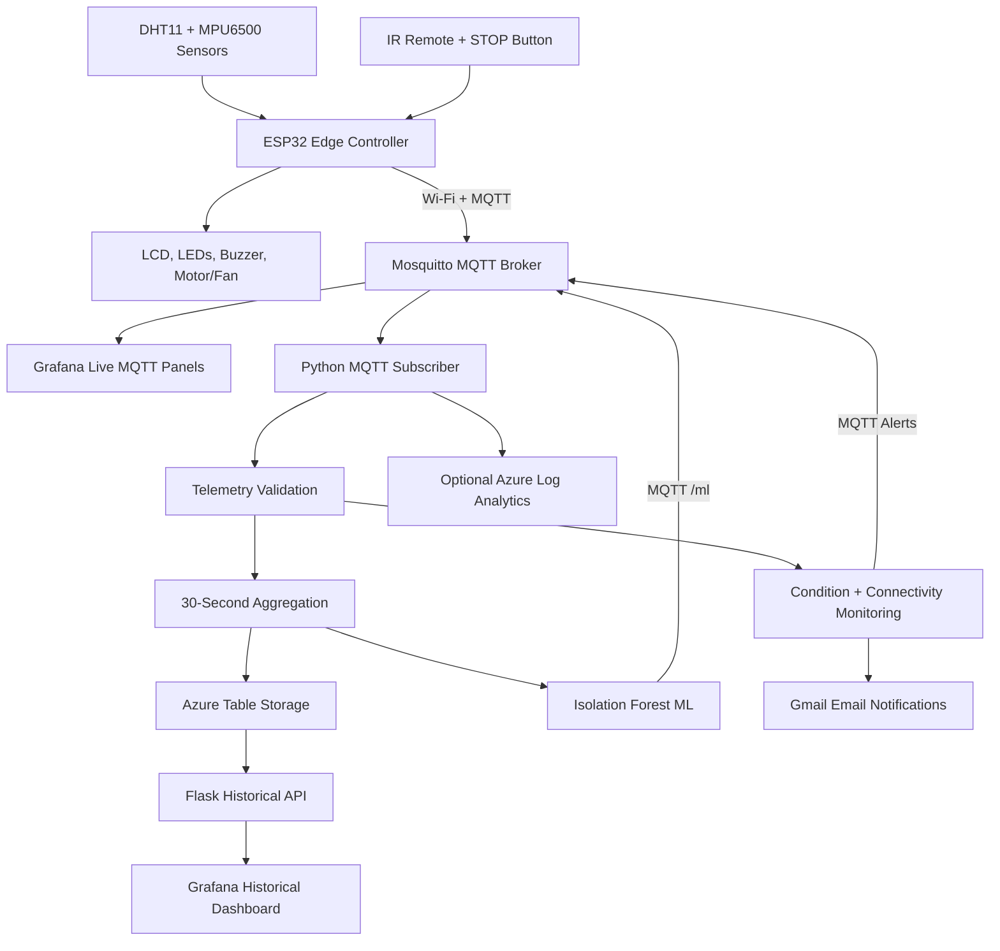

# IoT-Based Configurable Multi-Sensor Equipment Condition Monitoring System with AI/ML Integration

**ESP32 | MQTT | Python | Microsoft Azure | Grafana | Machine Learning | Email Alerts**


---

## 1. Project Overview

This project is an end-to-end Internet of Things (IoT) system designed to monitor equipment operating conditions using temperature, humidity, and vibration sensors.

An **ESP32 microcontroller** continuously collects sensor readings, applies configurable thresholds, and classifies equipment conditions into three levels:

- 🟢 **NORMAL** — Equipment is operating within configured limits.
- 🟡 **WARNING** — One or more readings exceed warning thresholds or required sensor data is unavailable.
- 🔴 **CRITICAL** — One or more readings exceed critical thresholds.

The ESP32 also controls local LEDs, an LCD display, a buzzer, and a demonstration DC motor/fan with software interlocks.

Sensor data is transmitted wirelessly through **MQTT** to a local Mosquitto broker. A **Python backend** validates telemetry, detects condition changes, monitors connectivity, aggregates sensor data, and stores historical records in **Microsoft Azure Table Storage**.

**Grafana** provides live and historical monitoring dashboards, while an **Isolation Forest machine-learning model** independently detects unusual sensor patterns.

The system also sends automatic **Gmail email notifications** for equipment warnings, critical conditions, recovery events, and device connectivity changes.

> **Important:** This is an academic proof-of-concept system, not a certified industrial safety controller or validated predictive-maintenance product.

---

## 2. Project Objectives

The main objectives are:

1. Integrate multiple physical sensors with an ESP32 microcontroller.
2. Measure temperature, humidity, and equipment vibration.
3. Implement configurable equipment condition thresholds.
4. Provide local monitoring through LEDs, LCD, and buzzer.
5. Demonstrate DC motor control with software safety interlocks.
6. Establish wireless communication using Wi-Fi and MQTT.
7. Develop a Python backend for telemetry validation and processing.
8. Store equipment history using Microsoft Azure.
9. Create real-time and historical dashboards using Grafana.
10. Apply machine learning to identify anomalous operating behavior.
11. Send automated email notifications for important events.
12. Test connectivity failures, malformed telemetry, cloud write failures, and recovery.

---

## 3. System Architecture



### Architecture Explanation

The system is divided into four layers.

| Layer | Responsibility |
|---|---|
| Edge Layer | ESP32 sensor readings, threshold classification, local display, buzzer and motor control |
| Communication Layer | MQTT messaging through Mosquitto |
| Backend and Cloud Layer | Python validation, aggregation, anomaly detection, email notifications and Azure storage |
| Visualization Layer | Grafana real-time monitoring and historical analysis |

**Edge processing:** The ESP32 handles local monitoring independently of Azure.

**Backend processing:** Python processes incoming telemetry and manages cloud and notification services.

**Cloud processing:** Azure stores historical equipment records.

**Visualization:** Grafana combines live MQTT readings with Azure historical data.

---

## 4. Technology Stack

| Category | Technologies |
|---|---|
| Microcontroller | ESP32 |
| Sensors | DHT11, MPU6500 |
| Hardware | LCD1602, 74HC595, LEDs, buzzer, IR receiver, STOP button, L293D motor driver, DC motor/fan |
| Embedded Programming | C++, Arduino Framework |
| Networking | Wi-Fi |
| IoT Communication | MQTT, Mosquitto |
| Backend | Python, Paho MQTT |
| Cloud Platform | Microsoft Azure |
| Cloud Storage | Azure Table Storage |
| Cloud Monitoring | Azure Monitor Log Analytics (optional) |
| REST API | Flask |
| Machine Learning | scikit-learn, Isolation Forest, pandas, NumPy, joblib |
| Visualization | Grafana, MQTT datasource, Infinity datasource, Business Text |
| Email | Gmail SMTP, STARTTLS, certifi |
| Development | VS Code, Arduino IDE, Git, GitHub |
| Development Computer | MacBook Air M2 |

---

## 5. Hardware Components

The monitoring prototype includes:

- ESP32 microcontroller
- DHT11 temperature and humidity sensor
- MPU6500 accelerometer for vibration measurement
- LCD1602 display
- 74HC595 shift register
- Green, yellow and red indicator LEDs
- Buzzer
- IR receiver and remote control
- Physical STOP button
- L293D motor driver
- DC motor/fan
- Breadboard, resistors, jumper wires and power connections

### ESP32 GPIO Configuration

The following GPIO assignments are defined in the firmware.

| Component | ESP32 GPIO |
|---|---|
| DHT11 Data | GPIO 27 |
| MPU6500 SDA | GPIO 21 |
| MPU6500 SCL | GPIO 22 |
| Green LED | GPIO 25 |
| Yellow LED | GPIO 26 |
| Red LED | GPIO 33 |
| Buzzer | GPIO 23 |
| IR Receiver | GPIO 32 |
| STOP Button | GPIO 13 |
| L293D EN | GPIO 4 |
| L293D IN1 | GPIO 2 |
| L293D IN2 | GPIO 15 |
| 74HC595 SER | GPIO 18 |
| 74HC595 SRCLK | GPIO 19 |
| 74HC595 RCLK | GPIO 5 |

### Sensor Operation

**DHT11**

Provides:

- Ambient temperature in °C
- Relative humidity in %

**MPU6500**

Provides acceleration measurements along the X, Y, and Z axes.

The firmware collects acceleration samples, removes the mean acceleration for each axis, and calculates a dynamic acceleration RMS metric representing vibration.

### Motor Interlocks

The ESP32 software includes:

- Motor arming and disarming
- Motor start/stop control
- Latching STOP behavior
- Motor shutdown when required sensors become invalid
- Motor restrictions during critical conditions
- Explicit reset/re-arming behavior

These are demonstration software interlocks, not safety-rated emergency-stop hardware.

**Electrical safety:** Verify component voltage limits, current-limiting resistors, common grounds and motor-driver power wiring before energizing the circuit.

---

## 6. Equipment Condition Classification

The ESP32 evaluates temperature, humidity and vibration against configurable thresholds.

### Default Thresholds

| Sensor | WARNING | CRITICAL |
|---|---:|---:|
| Temperature | 32°C | 40°C |
| Humidity | 75% | 90% |
| Vibration Metric | 1.0 | 3.0 |

These values are demonstration settings, not industrial equipment standards.

### Classification Logic

**NORMAL**

All valid sensor measurements remain below their warning thresholds.

**WARNING**

At least one measurement reaches a warning threshold, or required sensor data is unavailable.

**CRITICAL**

At least one measurement reaches a critical threshold.

Critical conditions take precedence over warnings.

### Local Indicators

| Condition | Indicator |
|---|---|
| NORMAL | Green LED |
| WARNING | Yellow LED |
| CRITICAL | Red LED and configured buzzer pattern |

The LCD displays operating information, and the IR remote provides configurable control and demonstration modes.

---

## 7. MQTT Communication

The ESP32 communicates with a locally hosted Mosquitto MQTT broker.

**Development broker:** Mosquitto on macOS  
**MQTT TCP port:** `1883`  
**Device ID:** `ESP32-001`

The ESP32 publishes telemetry approximately every two seconds.

### MQTT Topics

| Topic | Purpose |
|---|---|
| `equipment/ESP32-001/telemetry` | Live sensor measurements |
| `equipment/ESP32-001/status` | ESP32 connection/status information |
| `equipment/ESP32-001/alerts` | Backend condition-change alerts |
| `equipment/ESP32-001/connectivity` | Backend ONLINE/OFFLINE status |
| `equipment/ESP32-001/ml` | Live machine-learning predictions |

### Example MQTT Telemetry

```json
{
  "device_id": "ESP32-001",
  "temperature": 25.3,
  "humidity": 55.0,
  "vibration": 0.079,
  "condition": "NORMAL"
}
```

This is an illustrative subset of the telemetry payload. The actual firmware also publishes operating-state information.

### MQTT Validation

The backend checks incoming telemetry before processing.

Validation includes:

- Required field verification
- Numeric measurement validation
- Rejection of nonfinite numeric values
- Equipment condition validation
- Device ID validation
- Malformed JSON handling

Invalid readings are rejected without intentionally terminating the subscriber.

---

## 8. Python Backend

The main backend service is:

`backend/mqtt/subscriber.py`

It performs:

1. MQTT connection and subscription
2. JSON parsing and validation
3. Equipment condition-change detection
4. Local connectivity monitoring
5. Thirty-second sensor aggregation
6. Azure Table Storage uploads
7. Isolation Forest inference
8. MQTT alert publishing
9. Email notification dispatch
10. Optional Azure Log Analytics ingestion

### Condition-Change Detection

The backend tracks the previous equipment condition.

For example:

```text
NORMAL → WARNING
WARNING → CRITICAL
CRITICAL → NORMAL
```

A new condition-change event is generated only when the condition changes.

Repeated identical WARNING readings do not continuously generate new WARNING emails.

### Connectivity Monitoring

The backend checks the time elapsed since the most recent valid telemetry message.

**Offline timeout:** Approximately 10 seconds

**Connectivity check interval:** Approximately 2 seconds

When valid telemetry stops beyond the timeout, the backend identifies the device as OFFLINE.

When valid telemetry resumes, the backend identifies the device as ONLINE.

The status is published through MQTT and can trigger email notifications.

---

## 9. Thirty-Second Telemetry Aggregation

Instead of saving every individual MQTT message to cloud storage, the backend calculates approximately 30-second summaries.

Each completed summary includes:

- Average temperature
- Minimum temperature
- Maximum temperature
- Latest temperature
- Average humidity
- Minimum humidity
- Maximum humidity
- Latest humidity
- Average vibration
- Minimum vibration
- Maximum vibration
- Latest vibration
- Sample counts
- Latest equipment condition
- Worst condition during the window
- Selected ESP32 operating-state fields

### Storage Efficiency

At one summary every 30 seconds:

```text
2 summaries/minute
120 summaries/hour
2,880 summaries/day
```

These are theoretical counts for continuous operation. Actual records depend on sensor validity, service uptime and successful processing.

---

## 10. Microsoft Azure Integration

The system stores historical equipment data using Azure Table Storage.

**Azure Storage Account:** `stiotequipmentmonitor01`

**Azure Table:** `EquipmentTelemetry`

### Record Types

| Record Type | Purpose |
|---|---|
| SUMMARY | Aggregated sensor measurements |
| EVENT | Equipment condition transitions |
| LEGACY | Earlier individual telemetry records |

### SUMMARY Records

SUMMARY records contain statistical measurements, timestamps, equipment conditions and operational status.

### EVENT Records

EVENT records contain:

- Device ID
- Timestamp
- Previous condition
- Current condition
- Event type
- Temperature
- Humidity
- Vibration
- Selected equipment state fields

### Azure Write Recovery

The Python subscriber maintains an in-memory queue for failed Azure Table Storage writes.

**Maximum queued records:** 1,000

If a write fails, the record is retained for another attempt during subsequent processing.

**Limitation:** The queue is stored in RAM and is not persistent. Pending records may be lost when the Python process or Mac stops.

### Optional Azure Log Analytics

The project also includes optional Azure Monitor Logs Ingestion support.

This feature requires Azure authentication credentials, a Data Collection Rule, and the appropriate ingestion endpoint.

It is separate from Azure Table Storage.

---

## 11. Historical Flask API

A Flask REST API retrieves historical equipment information from Azure Table Storage.

**Local API Address:**

`http://127.0.0.1:5001`

### API Endpoints

| Endpoint | Purpose |
|---|---|
| `GET /api/health` | API health check |
| `GET /api/history/summary` | Historical aggregated data |
| `GET /api/history/events` | Historical equipment events |

### Example Historical Queries

```text
http://127.0.0.1:5001/api/history/summary?from=2026-10-11&to=2026-10-14&limit=500
```

```text
http://127.0.0.1:5001/api/history/events?from=2026-10-11&to=2026-10-14&limit=500
```

The API supports date-filtered queries with a maximum limit of **25,000 records per request**.

Dates are interpreted as UTC calendar dates. The API does not currently provide full pagination or precise rolling-time filtering.

---

## 12. Grafana Dashboard

Grafana provides equipment visualization through live MQTT data and historical Azure records.

### Dashboard Features

- Live temperature
- Live humidity
- Live vibration
- Current equipment condition
- Equipment condition-change alerts
- Device connectivity status
- Isolation Forest anomaly status
- Anomaly score
- Historical sensor trends
- Historical equipment event table

### Dashboard Export

[View Grafana Dashboard JSON](dashboard/grafana/iot-equipment-live-dashboard.json)

### Seven-Day Historical Sensor Trends

Grafana Infinity URL:

```text
http://127.0.0.1:5001/api/history/summary?from=${__from:date:YYYY-MM-DD}&to=${__to:date:YYYY-MM-DD}&limit=25000
```

**Panel Relative Time:** `7d`

### Seven-Day Historical Equipment Alerts

Grafana Infinity URL:

```text
http://127.0.0.1:5001/api/history/events?from=${__from:date:YYYY-MM-DD}&to=${__to:date:YYYY-MM-DD}&limit=25000
```

**Panel Relative Time:** `7d`

### Historical Alert Table

The event table displays:

| Time | Current Condition | Previous Condition | Temperature | Humidity | Vibration |
|---|---|---|---|---|---|

The seven-day configuration provides a moving query window. It does not mean seven days of data have already been collected.

The dashboard JSON was exported using Grafana 13.2.3. Importing it into another Grafana version may require datasource remapping or format adjustments.

---

## 13. Machine Learning — Isolation Forest

The system uses an unsupervised Isolation Forest model to identify unusual equipment sensor patterns.

Unlike threshold-based classification, the ML model evaluates relationships between multiple measurements.

### Training Dataset

The model was trained using historical SUMMARY records retrieved from Azure Table Storage.

Earlier NORMAL-condition windows were used for model training.

A chronological train/test split was used to separate earlier data from later evaluation data.

### Input Features

| Feature | Description |
|---|---|
| `TemperatureAvg` | Average temperature |
| `HumidityAvg` | Average humidity |
| `VibrationAvg` | Average vibration |
| `VibrationMax` | Maximum vibration |

### Model Configuration

| Parameter | Value |
|---|---|
| Algorithm | Isolation Forest |
| Estimators | 200 |
| Contamination | 0.05 |
| Random State | 42 |
| Train/Test Split | Chronological 75% / 25% |
| Prediction Output | NORMAL / ANOMALY |
| Inference Interval | Approximately 30 seconds |

### Model Storage

The trained model is saved at:

`ml/models/isolation_forest.joblib`

### Inference

The backend loads the model and analyzes completed sensor summaries.

Example output:

```json
{
  "device_id": "ESP32-001",
  "status": "NORMAL",
  "anomaly_score": -0.12,
  "model": "IsolationForest"
}
```

The actual output also includes timestamp and input feature values.

### Understanding the Anomaly Score

The project calculates:

```python
anomaly_score = -model.decision_function(input_data)[0]
```

A positive score indicates anomalous behavior under the current model's decision threshold.

A negative score indicates behavior on the normal side of that threshold.

**The anomaly score is not an equipment-failure probability.**

### Rule-Based Versus ML Detection

| Rule-Based Detection | ML Detection |
|---|---|
| Uses configured thresholds | Uses learned statistical patterns |
| Runs on ESP32 | Runs in Python backend |
| NORMAL / WARNING / CRITICAL | NORMAL / ANOMALY |
| Controls local indicators/interlocks | Publishes additional anomaly information |

The two methods operate independently.

Historical ML prediction storage is not part of the current project scope.

---

## 14. Email Notifications

The system uses Gmail SMTP for automated equipment notifications.

### Implemented Notification Types

| Notification | Trigger |
|---|---|
| WARNING | Equipment enters WARNING |
| CRITICAL | Equipment enters CRITICAL |
| RECOVERY | Equipment returns to NORMAL |
| DEVICE OFFLINE | Valid telemetry stops beyond timeout |
| DEVICE ONLINE | Valid telemetry resumes after OFFLINE |

### Email Implementation

The backend uses:

- Python `smtplib`
- Gmail SMTP
- STARTTLS encryption
- Certificate verification using `certifi`
- Private environment variables
- Background email worker
- Bounded email queue
- Retry attempts for transient SMTP failures

### Example Notification

```text
Subject: WARNING - IoT Equipment Alert

IoT EQUIPMENT CONDITION MONITORING SYSTEM

Alert: WARNING
Device: ESP32-001
Previous Condition: NORMAL
Temperature: 34.0 C
Humidity: 65.0 %
Vibration: 0.15
Time: 2026-10-13T18:00:00+00:00
```

Email notifications are transition-based and best effort.

**SMS notifications are not included in this project.**

---

## 15. Installation and Setup

### Prerequisites

- macOS development computer
- Python 3
- Homebrew
- Mosquitto MQTT broker
- Grafana
- Arduino IDE
- ESP32 board and hardware components
- Microsoft Azure Table Storage access
- Optional Gmail App Password

### Step 1 — Clone Repository

```bash
git clone https://github.com/dp0912/IoT-Equipment-Condition-Monitoring-System.git
cd IoT-Equipment-Condition-Monitoring-System
```

### Step 2 — Create Python Virtual Environment

```bash
python3 -m venv .venv
source .venv/bin/activate
```

### Step 3 — Install Python Dependencies

```bash
python -m pip install -r requirements.txt
```

### Step 4 — Configure Environment Variables

Create a private `.env` file in the project root.

Example:

```dotenv
MQTT_HOST=YOUR_MAC_IP_ADDRESS
MQTT_PASSWORD=YOUR_MQTT_PASSWORD

AZURE_STORAGE_CONNECTION_STRING=YOUR_AZURE_CONNECTION_STRING
AZURE_TABLE_NAME=EquipmentTelemetry

AZURE_LOG_ANALYTICS_ENABLED=false

EMAIL_ENABLED=false
SMTP_HOST=smtp.gmail.com
SMTP_PORT=587
SMTP_USER=YOUR_GMAIL_ADDRESS
SMTP_APP_PASSWORD=YOUR_GMAIL_APP_PASSWORD
ALERT_EMAIL_TO=YOUR_EMAIL_ADDRESS
```

Set `EMAIL_ENABLED=true` after configuring the email credentials.

The ESP32 firmware uses a separate local `secrets.h` file containing Wi-Fi and MQTT credentials.

**Never upload `.env`, `secrets.h`, passwords, API keys or Azure connection strings to GitHub.**

### Step 5 — Start Mosquitto

```bash
brew services start mosquitto
```

### Step 6 — Start Grafana

```bash
brew services start grafana
```

### Step 7 — Start Python MQTT Subscriber

Open a terminal in the project directory:

```bash
source .venv/bin/activate
python backend/mqtt/subscriber.py
```

Keep the subscriber running.

### Step 8 — Start Historical API

Open another terminal:

```bash
source .venv/bin/activate
python backend/azure/history_api.py
```

Keep the API running.

### Step 9 — Connect ESP32

Power the ESP32 and verify that it connects to Wi-Fi and the MQTT broker.

### Step 10 — Open Grafana

Open:

`http://localhost:3000`

API health check:

`http://127.0.0.1:5001/api/health`

Import the Grafana dashboard configuration and configure the appropriate MQTT and Infinity datasources.

### Stop Services

Use `Ctrl+C` to stop each Python program.

Optionally stop Mosquitto and Grafana:

```bash
brew services stop mosquitto
brew services stop grafana
```

---

## 16. Security Considerations

The project follows basic security practices:

- MQTT broker authentication
- Credentials stored in ignored local files
- Azure credentials excluded from Git
- SMTP STARTTLS and certificate verification
- Environment-based configuration
- Sensor input validation
- Controlled local Flask binding
- Git ignore rules for local credentials

### Current Security Limitations

- MQTT communication currently uses local TCP without TLS.
- The development environment hosts multiple critical services.
- The project has not undergone a professional security audit.
- Motor interlocks are not safety-rated.

Future improvements could include MQTT over TLS, stronger service isolation, managed identities, and persistent retry storage.

---


## 17. Repository Structure

```text
IoT-Equipment-Condition-Monitoring-System/
├── firmware/
│   └── esp32/
│       └── equipment_monitor/
│           └── equipment_monitor.ino
│
├── backend/
│   ├── mqtt/
│   │   ├── subscriber.py
│   │   └── telemetry_aggregator.py
│   │
│   ├── azure/
│   │   ├── storage.py
│   │   ├── query_history.py
│   │   ├── history_api.py
│   │   └── log_analytics.py
│   │
│   └── notifications/
│       └── email_notifier.py
│
├── ml/
│   ├── training/
│   ├── inference/
│   └── models/
│       └── isolation_forest.joblib
│
├── dashboard/
│   ├── grafana/
│   │   └── iot-equipment-live-dashboard.json
│   └── screenshot/
│
├── hardware/
├── docs/
├── requirements.txt
├── .gitignore
└── README.md
```

---


