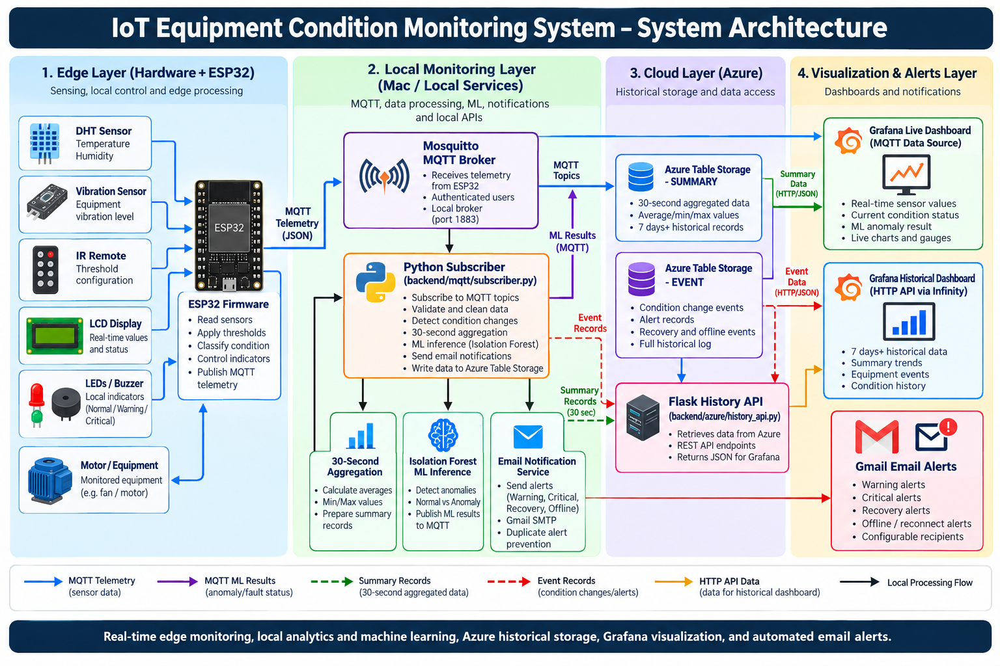
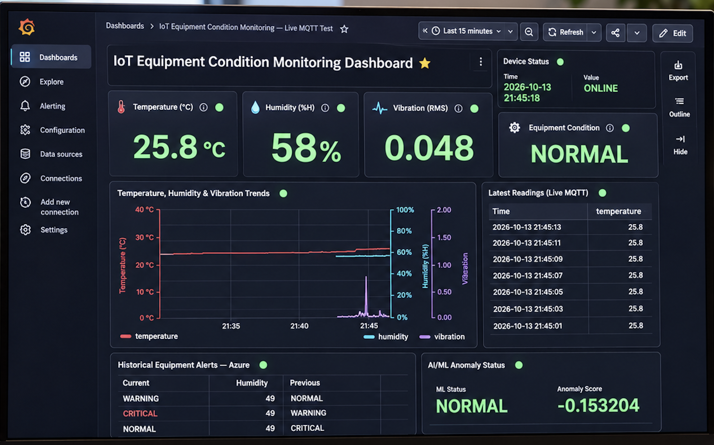

# IoT-Based Configurable Multi-Sensor Equipment Condition Monitoring System with AI/ML Integration

**ESP32 • MQTT • Python • Microsoft Azure • Grafana • Isolation Forest • Email Notifications**

An end-to-end IoT equipment monitoring prototype integrating **embedded sensors, real-time MQTT communication, local automation, Azure cloud storage, Grafana visualization, machine-learning anomaly detection, and automated email notifications**.

---

## 📌 Project Overview

This project implements an IoT-based equipment condition monitoring system that continuously measures **temperature, humidity, and vibration** using an ESP32 microcontroller.

The ESP32 processes sensor readings and uses configurable thresholds to determine the equipment's operating condition:

- 🟢 **NORMAL** — Equipment operating within configured limits.
- 🟡 **WARNING** — One or more measurements exceed warning thresholds, or required sensor data is unavailable.
- 🔴 **CRITICAL** — One or more measurements exceed critical thresholds.

Local indicators include a **16×2 LCD, LEDs, buzzer, IR remote, physical STOP button, and demonstration DC motor/fan** with software interlocks.

Telemetry is transmitted to a local **Mosquitto MQTT broker**, processed by a **Python backend**, and stored historically in **Azure Table Storage**.

**Grafana** displays real-time sensor measurements, equipment states, historical trends, connectivity, and AI/ML anomaly predictions.

The system also sends automatic **Gmail email notifications** for equipment warnings, critical conditions, recovery events, and device connectivity changes.

---

## 🏗️ Complete System Architecture



### How the System Works

The architecture consists of four main layers:

| Layer                         | Components                                                                 | Responsibilities                                                       |
| ----------------------------- | -------------------------------------------------------------------------- | ---------------------------------------------------------------------- |
| **1. Edge / Hardware**        | ESP32, DHT11, MPU6500, LCD, LEDs, buzzer, IR remote, motor                 | Sensor acquisition, threshold classification and local control         |
| **2. Local Monitoring**       | Mosquitto, Python subscriber, aggregation, Isolation Forest, email service | MQTT communication, validation, cloud uploads, AI/ML and notifications |
| **3. Azure Cloud**            | Azure Table Storage                                                        | Historical SUMMARY and EVENT records                                   |
| **4. Visualization & Alerts** | Grafana, Gmail                                                             | Live dashboard, historical charts and automated email alerts           |

### Main Data Flows

**Real-time monitoring:**

`ESP32 → Mosquitto MQTT Broker → Grafana Live Dashboard`

**Cloud historical monitoring:**

`ESP32 → Mosquitto → Python Subscriber → Azure Table Storage → Flask History API → Grafana Historical Dashboard`

**Machine learning:**

`Python Subscriber → 30-second aggregation → Isolation Forest → MQTT Broker → Grafana Live Dashboard`

**Email notifications:**

`Python Subscriber → Email Notification Service → Gmail SMTP → Recipient`

Grafana's live panels subscribe directly to Mosquitto through the MQTT datasource, independently of the Python subscriber.

---

## 📊 Grafana Monitoring Dashboard



The Grafana dashboard provides both **real-time equipment monitoring** and **historical analysis**.

### Dashboard Features

| Feature                     | Description                                               |
| --------------------------- | --------------------------------------------------------- |
| Temperature                 | Live temperature in °C                                    |
| Humidity                    | Live relative humidity (%)                                |
| Vibration                   | Live dynamic acceleration RMS                             |
| Equipment Condition         | NORMAL, WARNING or CRITICAL                               |
| Device Status               | ESP32 ONLINE/OFFLINE indication                           |
| Live Sensor Trends          | Temperature, humidity and vibration charts                |
| Latest Readings             | Recent MQTT sensor messages                               |
| Equipment Alerts            | WARNING, CRITICAL and RECOVERY transitions                |
| Device Connectivity         | Backend-calculated connectivity and last-seen information |
| Historical Sensor Trends    | Azure-based historical charts                             |
| Historical Equipment Alerts | Condition-change event history                            |
| AI/ML Anomaly Status        | Isolation Forest NORMAL/ANOMALY result and anomaly score  |

**Dashboard configuration:** [Grafana Dashboard JSON](dashboard/grafana/iot-equipment-live-dashboard.json)

**Original dashboard evidence:** [Real Grafana Screenshot](dashboard/screenshot/live-dashboard.png)

> The showcase image is a presentation visualization based on the working dashboard. The original screenshot and exported Grafana JSON provide evidence of the actual implementation.

---

## ⚙️ Hardware and Components

### Main Hardware

| Component               | Purpose                                           |
| ----------------------- | ------------------------------------------------- |
| ESP32                   | Edge controller with Wi-Fi connectivity           |
| DHT11                   | Temperature and humidity measurement              |
| MPU6500                 | Three-axis acceleration and vibration calculation |
| LCD1602                 | Local sensor and condition display                |
| 74HC595                 | Shift register for LCD control                    |
| Green, Yellow, Red LEDs | Local condition indication                        |
| Buzzer                  | Audible equipment alert                           |
| IR Remote               | Configuration and operating controls              |
| STOP Button             | Local software stop input                         |
| L293D                   | Motor driver                                      |
| DC Motor/Fan            | Demonstration equipment                           |

### Default Condition Thresholds

| Measurement      | WARNING | CRITICAL |
| ---------------- | ------: | -------: |
| Temperature      |    32°C |     40°C |
| Humidity         |     75% |      90% |
| Vibration Metric |     1.0 |      3.0 |

Thresholds are configurable through the firmware interface.

The ESP32 implements local motor arming, start/stop controls, STOP latching and motor restrictions during invalid sensor or critical conditions.

**Note:** Thresholds and motor interlocks are for academic demonstration and are not certified industrial safety controls.

**Firmware:** [equipment_monitor.ino](firmware/esp32/equipment_monitor/equipment_monitor.ino)

**Wiring reference:** [ESP32 Wiring Documentation](docs/wiring/esp32_wiring.md)

---

## 🛠️ Technology Stack

| Category                  | Technology                                    |
| ------------------------- | --------------------------------------------- |
| Embedded Hardware         | ESP32, DHT11, MPU6500                         |
| Embedded Programming      | C++ / Arduino Framework                       |
| Networking                | Wi-Fi, TCP/IP                                 |
| IoT Messaging             | MQTT / Mosquitto                              |
| Backend                   | Python, Paho MQTT                             |
| Cloud Platform            | Microsoft Azure                               |
| Cloud Storage             | Azure Table Storage                           |
| Optional Cloud Monitoring | Azure Monitor Log Analytics                   |
| Historical API            | Flask                                         |
| Visualization             | Grafana, MQTT and Infinity datasources        |
| Machine Learning          | scikit-learn, Isolation Forest, pandas, NumPy |
| Notifications             | Gmail SMTP with STARTTLS                      |
| Development Tools         | VS Code, Arduino IDE, Git and GitHub          |

---

## 📡 MQTT Communication

The ESP32 sends sensor telemetry approximately every **2 seconds** to the locally hosted Mosquitto broker.

### MQTT Topics

| Topic                              | Description                                          |
| ---------------------------------- | ---------------------------------------------------- |
| `equipment/ESP32-001/telemetry`    | Temperature, humidity, vibration and equipment state |
| `equipment/ESP32-001/status`       | ESP32 device status                                  |
| `equipment/ESP32-001/alerts`       | Condition-change alerts                              |
| `equipment/ESP32-001/connectivity` | Backend ONLINE/OFFLINE monitoring                    |
| `equipment/ESP32-001/ml`           | Isolation Forest predictions                         |

### Example Telemetry

```json
{
  "device_id": "ESP32-001",
  "temperature": 25.8,
  "humidity": 58.0,
  "vibration": 0.048,
  "condition": "NORMAL"
}
```

The actual ESP32 telemetry includes additional operating-state and sensor-validity fields.

The Python backend validates incoming messages before processing or cloud storage.

---

## ☁️ Azure Cloud Integration

The project uses **Microsoft Azure Table Storage** to preserve historical equipment data.

### Azure Storage Design

**Storage Account:** `stiotequipmentmonitor01`  
**Table:** `EquipmentTelemetry`

Two main record types are stored:

**SUMMARY records** are created approximately every 30 seconds and contain:

- Average, minimum, maximum and latest sensor measurements
- Valid sample counts
- Latest equipment condition
- Worst condition during the aggregation window
- Timestamp and device metadata

**EVENT records** are created when equipment changes operating condition.

Examples:

`NORMAL → WARNING`  
`WARNING → CRITICAL`  
`CRITICAL → NORMAL`

This approach reduces cloud storage writes compared with storing every two-second telemetry message.

### Azure Recovery Handling

The backend includes an **in-memory retry queue** for failed Azure storage uploads, with a capacity of up to 1,000 pending records.

Failed records can be retried during subsequent processing.

The queue is not disk-persistent, so unsaved records may be lost if the backend stops.

---

## 🤖 AI/ML Anomaly Detection

The project uses an **Isolation Forest** model trained on historical Azure SUMMARY records to identify unusual equipment behavior.

### Machine-Learning Features

| Feature        | Meaning             |
| -------------- | ------------------- |
| TemperatureAvg | Average temperature |
| HumidityAvg    | Average humidity    |
| VibrationAvg   | Average vibration   |
| VibrationMax   | Maximum vibration   |

### Model Configuration

| Parameter           | Value                          |
| ------------------- | ------------------------------ |
| Algorithm           | Isolation Forest               |
| Number of Trees     | 200                            |
| Contamination       | 0.05                           |
| Random State        | 42                             |
| Dataset Split       | Chronological 75% / 25%        |
| Output              | NORMAL / ANOMALY               |
| Inference Frequency | Approximately every 30 seconds |

The trained model is stored at:

`ml/models/isolation_forest.joblib`

Predictions are published back to MQTT and displayed in Grafana.

**Important:** ML anomaly detection operates independently of the ESP32's rule-based condition classification. An anomaly score is not a probability of mechanical failure.

---

## 📧 Automated Email Notifications

The Python backend sends transition-based notifications using Gmail SMTP.

| Notification   | Trigger                                            |
| -------------- | -------------------------------------------------- |
| WARNING        | Equipment enters WARNING                           |
| CRITICAL       | Equipment enters CRITICAL                          |
| RECOVERY       | Equipment returns to NORMAL                        |
| DEVICE OFFLINE | No valid telemetry beyond approximately 10 seconds |
| DEVICE ONLINE  | Valid telemetry resumes after an offline event     |

Email processing uses a background worker, STARTTLS encryption and TLS certificate verification.

Repeated identical equipment conditions do not continuously generate duplicate transition emails.

No SMS notification feature is included.

---

## 🚀 Installation and Running the Project

### Prerequisites

- macOS with Homebrew
- Python 3 and pip
- Arduino IDE and ESP32 libraries
- Configured Mosquitto MQTT broker
- Grafana with required plugins
- Azure Storage account and table
- ESP32 hardware and configured firmware
- Gmail App Password if email notifications are enabled

### 1. Clone Repository

```bash
git clone https://github.com/dp0912/IoT-Equipment-Condition-Monitoring-System.git
cd IoT-Equipment-Condition-Monitoring-System
```

### 2. Configure Python Environment

```bash
python3 -m venv .venv
source .venv/bin/activate
python -m pip install -r requirements.txt
```

### 3. Configure Environment Variables

Create a private `.env` file in the project root.

```dotenv
MQTT_HOST=YOUR_MAC_LAN_IP
MQTT_PASSWORD=YOUR_MQTT_PASSWORD

AZURE_STORAGE_CONNECTION_STRING=YOUR_AZURE_CONNECTION_STRING
AZURE_TABLE_NAME=EquipmentTelemetry
AZURE_LOG_ANALYTICS_ENABLED=false

EMAIL_ENABLED=false
SMTP_HOST=smtp.gmail.com
SMTP_PORT=587
SMTP_USER=YOUR_GMAIL_ADDRESS
SMTP_APP_PASSWORD=YOUR_GMAIL_APP_PASSWORD
ALERT_EMAIL_TO=YOUR_EMAIL_ADDRESS
```

Set `EMAIL_ENABLED=true` when valid SMTP credentials are configured.

The ESP32 firmware requires a separate, private `secrets.h` file for Wi-Fi and MQTT settings.

**Never commit credentials, `.env` or `secrets.h` to GitHub.**

### 4. Start Mosquitto and Grafana

```bash
brew services start mosquitto
brew services start grafana
```

If Mosquitto reports a startup error, check whether another broker instance is already listening on TCP port 1883 before restarting it.

### 5. Start Python MQTT Subscriber

Open a VS Code terminal:

```bash
source .venv/bin/activate
python backend/mqtt/subscriber.py
```

Keep this terminal running.

### 6. Start Azure Historical API

Open a second terminal:

```bash
source .venv/bin/activate
python backend/azure/history_api.py
```

### 7. Open the Dashboard

**Grafana:** http://localhost:3000

**History API health:** http://127.0.0.1:5001/api/health

Power the ESP32, confirm MQTT connectivity, and open the imported Grafana dashboard.

### 8. Stop the System

Press `Ctrl+C` in each Python terminal.

Optionally stop the background services:

```bash
brew services stop mosquitto
brew services stop grafana
```

---

## 🧪 Testing and Validation

The prototype has undergone functional and simulated failure testing.

| Test                                 | Result                |
| ------------------------------------ | --------------------- |
| ESP32 disconnection and reconnection | ✅ Passed             |
| OFFLINE and ONLINE detection         | ✅ Passed             |
| Email notification sending           | ✅ Observed           |
| Mosquitto stop/start recovery        | ✅ Processing resumed |
| Invalid numeric telemetry rejection  | ✅ Passed             |
| Azure write failure and retry        | ✅ Passed using mocks |
| Duplicate WARNING email prevention   | ✅ Passed using mocks |
| Azure SUMMARY and EVENT retrieval    | ✅ Passed             |
| Isolation Forest live inference      | ✅ Observed           |

### Historical Data Verification

During October 2026 testing, Azure history retrieval returned:

| Record Type | Records Retrieved |
| ----------- | ----------------: |
| SUMMARY     |             1,708 |
| EVENT       |               242 |

The retrieved records covered approximately October 11–14, 2026 UTC. These counts are historical test results, not live totals.

The Grafana history panels support a moving seven-day query window, but only data that has actually been collected can be displayed.

**Hardware testing:** [Hardware Test Results](docs/testing/hardware_test_results.md)

---

## 🔒 Security and Current Limitations

The implementation uses MQTT authentication, private configuration files, input validation and TLS-protected SMTP.

Current limitations include:

- MQTT uses local TCP without TLS.
- Mosquitto, Python services and Grafana depend on the local development computer.
- Azure retry records are kept in memory rather than durable disk storage.
- Email notifications are best effort.
- The historical API uses UTC calendar-date filtering and a 25,000-record request limit.
- The ML model is not validated against independently labeled physical equipment failures.
- Motor STOP/interlock features are software demonstrations, not safety-certified protections.

Potential improvements include MQTT/TLS, persistent Azure retry storage, automated testing, Docker deployment, improved historical pagination and extended ML evaluation.

---

## 📁 Repository Structure

```text
IoT-Equipment-Condition-Monitoring-System/
├── firmware/
│   └── esp32/equipment_monitor/
├── backend/
│   ├── mqtt/
│   ├── azure/
│   └── notifications/
├── ml/
│   ├── training/
│   ├── inference/
│   └── models/
├── dashboard/
│   ├── grafana/
│   └── screenshot/
├── docs/
│   ├── architecture/
│   ├── wiring/
│   └── testing/
├── hardware/
├── requirements.txt
├── .gitignore
└── README.md
```

---

## 🎓 Project Information

**Project:** IoT-Based Configurable Multi-Sensor Equipment Condition Monitoring System with AI/ML Integration

---

This project demonstrates the integration of **embedded systems, IoT messaging, Python automation, Azure cloud services, Grafana dashboards, machine learning, system monitoring, automated notifications, and reliability testing**.
