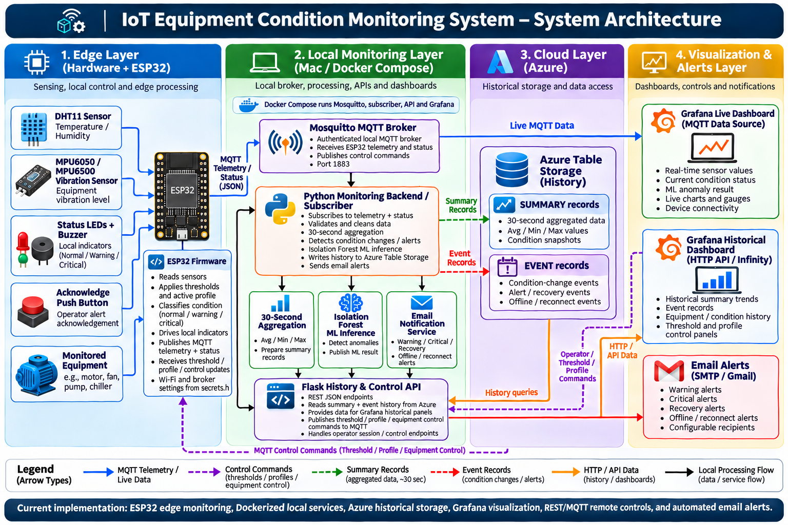
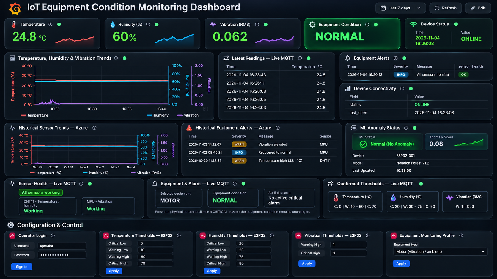

<div align="center">

# ⚙️ IoT Equipment Condition Monitoring System

### Intelligent Edge Monitoring • Docker Infrastructure • Cloud Analytics • Machine Learning

**An end-to-end Industrial IoT prototype combining real-time sensor monitoring, edge intelligence, containerized backend services, cloud-based analytics, machine learning, and automated equipment alerts.**

<br>


<br>


**[Overview](#-project-overview) · [Architecture](#-system-architecture) · [Features](#-key-features) · [Dashboard](#-grafana-dashboard) · [Docker](#-docker-infrastructure) · [Quick Start](#-quick-start) · [Documentation](#-project-documentation)**

</div>

---

## 📖 Project Overview

The **IoT Equipment Condition Monitoring System** is an Industrial Internet of Things (IIoT) prototype developed for **SOFE 4610U — Design of IoT** at Ontario Tech University.

The system uses an **ESP32-WROOM-32** microcontroller with **DHT11** and **MPU6050/MPU6500** sensors to measure temperature, humidity, and vibration.

Sensor measurements are processed locally to classify equipment conditions as **NORMAL**, **WARNING**, or **CRITICAL**. The ESP32 controls physical indicators and publishes telemetry through the MQTT protocol.

The backend integrates:

- **Eclipse Mosquitto** for MQTT messaging.
- **Python** for telemetry ingestion and processing.
- **Scikit-learn Isolation Forest** for anomaly detection.
- **Microsoft Azure Table Storage** for historical monitoring records.
- **Flask** for historical data and authenticated remote controls.
- **Grafana** for real-time visualization and equipment configuration.
- **SMTP** for configurable email notifications.
- **Docker Compose** for containerized local infrastructure.

The platform provides a foundation for configurable equipment condition monitoring and demonstrates the integration of embedded systems, IoT communication, cloud services, analytics, and machine learning.

### Supported Equipment Profiles

The system supports eight configurable equipment monitoring profiles:

`MOTOR` · `PUMP` · `COMPRESSOR` · `FAN` · `CONDENSER` · `HEAT_EXCHANGER` · `AHU` · `CHILLER`

Each profile contains configurable temperature, humidity, and vibration thresholds.

> **Project scope:** The current prototype uses one ESP32 to monitor one selected equipment profile at a time. It does not directly control physical industrial equipment. Monitoring thresholds and anomaly predictions are educational demonstrations rather than certified industrial safety systems.

---

## 🏗️ System Architecture

The system uses a layered IoT architecture separating edge processing, communication, backend services, cloud storage, and visualization.

<div align="center">



<sub>System Architecture — ESP32 Edge Processing, MQTT, Python Services, Azure Storage, Grafana and Alerts</sub>

</div>

### Architecture Layers

| Layer | Technologies | Responsibilities |
|---|---|---|
| **Device & Edge** | ESP32, DHT11, MPU6050/MPU6500 | Sensor acquisition, threshold evaluation, local indicators |
| **Communication** | MQTT, Eclipse Mosquitto | Device messaging, telemetry distribution, commands |
| **Backend & Processing** | Python, Paho MQTT, Scikit-learn | Data ingestion, aggregation, anomaly detection, notifications |
| **Cloud Storage** | Azure Table Storage | Historical summaries and condition-change records |
| **API & Control** | Flask, Waitress | Historical data retrieval and authenticated remote configuration |
| **Visualization** | Grafana | Live monitoring, historical trends, alerts, equipment configuration |
| **Infrastructure** | Docker, Docker Compose | Container orchestration and persistent service data |

### Telemetry Flow

```text
ESP32 Sensors
     |
     v
Edge Sensor Processing
     |
     v
MQTT Telemetry
     |
     v
Docker Mosquitto Broker
     |
     v
Python MQTT Subscriber
     |
     +------------------------+
     |                        |
     v                        v
Data Aggregation        Isolation Forest ML
     |                        |
     v                        v
Azure Table Storage     MQTT Anomaly Results
     |                        |
     +------------+-----------+
                  |
                  v
           Flask History API
                  |
                  v
            Grafana Dashboard
```

### Operator Control Flow

```text
Grafana Dashboard
       |
       v
Operator Authentication
       |
       v
Flask Control API
       |
       v
MQTT Command
       |
       v
ESP32
       |
       v
Configuration Applied / Rejected
       |
       v
MQTT Acknowledgement
       |
       v
Flask API / Grafana
```

Operator configuration changes are reported as successfully applied only after the corresponding ESP32 acknowledgement is received.

---

## ✨ Key Features

| Feature | Description |
|---|---|
| 📡 **Real-Time Monitoring** | Temperature, humidity and vibration telemetry approximately every 2.5 seconds |
| 🚦 **Condition Detection** | Edge-based NORMAL, WARNING and CRITICAL classification |
| 🔔 **Local Alerts** | Green, yellow and red LEDs, audible buzzer and acknowledgement button |
| 🏭 **Equipment Profiles** | Eight selectable profiles with configurable thresholds |
| 🔐 **Operator Authentication** | Separate operator Sign In / Sign Out controls |
| 🎛️ **Remote Configuration** | MQTT-based profile and threshold updates |
| ✅ **Command Acknowledgement** | ESP32 confirms applied or rejected changes |
| 🔒 **Access Protection** | Flask sessions, CSRF protection and protected control endpoints |
| 💾 **Persistent Configuration** | ESP32 stores profile and threshold settings |
| ☁️ **Azure Integration** | Historical sensor summaries and equipment events |
| 🤖 **ML Anomaly Detection** | Isolation Forest inference on aggregated telemetry |
| 📧 **Email Notifications** | Configurable equipment and connectivity notifications |
| 📊 **Grafana Dashboard** | Live telemetry, historical trends, anomaly results and controls |
| 🐳 **Docker Compose** | Containerized Mosquitto, subscriber, API and Grafana services |
| 📶 **Connectivity Monitoring** | Online/offline detection and device status updates |

### Current Development Status

The core monitoring pipeline has been demonstrated successfully.

**Verified integration results include:**

- ESP32 sensor measurements received by the Docker MQTT subscriber.
- Live temperature, humidity and vibration telemetry.
- Successful MQTT broker authentication and communication.
- Isolation Forest model loading and anomaly inference.
- Generation of approximately 30-second telemetry summaries.
- Successful Azure Table Storage SUMMARY writes.
- Flask API health endpoint returning `status: OK`.
- Flask API reporting an active MQTT connection.
- Four Docker Compose services running.
- Grafana dashboard functioning with the monitoring environment.

**Remaining validation:**

- Comprehensive WARNING and CRITICAL condition testing.
- Physical and remote alarm acknowledgement.
- Profile and threshold configuration tests.
- Operator authentication and authorization tests.
- Email delivery and recovery notification tests.
- Device disconnection, reconnection and recovery.
- Longer-duration reliability testing.

> **SMS notifications:** Critical SMS/text alerts are a planned enhancement. They are not part of the currently verified implementation.

---

## 📊 Grafana Dashboard

The Grafana dashboard provides a centralized interface for monitoring equipment health, analyzing historical sensor data, detecting anomalies, and configuring equipment profiles.

<div align="center">



<sub>Grafana dashboard showcase for the equipment condition monitoring prototype.</sub>

</div>

### Dashboard Capabilities

| Real-Time Monitoring | Analytics & Configuration |
|---|---|
| Temperature measurements | Azure historical trends |
| Humidity measurements | Historical equipment conditions |
| Vibration measurements | Isolation Forest anomaly results |
| Equipment condition | Operator authentication |
| Sensor health | Equipment profile selection |
| Device connectivity | Configurable thresholds |
| Local alarm state | Remote commands and acknowledgements |

### 🔐 Operator Authentication & Access Control

The dashboard includes an operator authentication mechanism separate from Grafana's own user login.

Operators authenticate through the Flask backend before making equipment configuration changes.

The **Operator Access** panel provides:

- Username and password authentication.
- Sign In and Sign Out functionality.
- Current operator session status.
- Access restrictions for configuration operations.

#### Operator Permissions

| Function | Signed Out | Signed In |
|---|---|---|
| View permitted live sensor data | ✅ | ✅ |
| View equipment condition | ✅ | ✅ |
| View historical Azure data | ✅ | ✅ |
| View alerts and sensor health | ✅ | ✅ |
| Change temperature thresholds | 🔒 | ✅ |
| Change humidity thresholds | 🔒 | ✅ |
| Change vibration thresholds | 🔒 | ✅ |
| Change equipment profile | 🔒 | ✅ |
| Access protected configuration endpoints | 🔒 | ✅ |

Dashboard viewing remains subject to Grafana permissions. Operator authentication independently protects equipment configuration operations.

### Authentication Workflow

**1. Signed Out**

The operator session is inactive. Protected configuration requests are rejected.

**2. Sign In**

An operator enters the configured credentials. The Flask backend validates the request and establishes an authenticated session.

**3. Equipment Configuration**

After authentication, the operator can select an equipment profile or update thresholds.

The backend publishes the corresponding MQTT command to the ESP32.

**4. Command Confirmation**

The ESP32 validates the command, applies or rejects the requested change, and publishes an acknowledgement.

**5. Sign Out**

The authenticated session is terminated, and protected configuration operations become unavailable.

### Authentication Security

The application implements protections including:

- Environment-based operator credentials.
- Flask session management.
- CSRF protection.
- Authentication checks on protected endpoints.
- Login attempt rate limiting.
- Session expiration.
- ESP32 command acknowledgements.

Authentication credentials are not intended to be stored inside the exported Grafana dashboard JSON.

> The Flask control API is designed for local development and should not be exposed directly to the public internet without additional production security controls.

### Grafana Technologies

The dashboard uses:

- **Grafana MQTT Data Source** for real-time telemetry.
- **Infinity Data Source** for historical information through the Flask API.
- **Business Forms** for configuration and operator controls.
- **Dynamic Text** for customized device and anomaly displays.

**[View Grafana Dashboard JSON](dashboard/grafana/iot-equipment-live-dashboard.json)**

---

## 🔧 Hardware & Edge Processing

### ESP32 Hardware Configuration

| Component | ESP32 GPIO | Purpose |
|---|---|---|
| DHT11 | GPIO27 | Temperature and humidity |
| MPU6050/MPU6500 SDA | GPIO21 | I²C data |
| MPU6050/MPU6500 SCL | GPIO22 | I²C clock |
| Green LED | GPIO25 | NORMAL condition |
| Yellow LED | GPIO26 | WARNING condition |
| Red LED | GPIO33 | CRITICAL condition |
| Push Button | GPIO13 | Alarm acknowledgement |
| Active Buzzer | GPIO23 | Audible critical alert |

### Condition Classification

| Condition | Local Response |
|---|---|
| 🟢 **NORMAL** | Green LED activated |
| 🟡 **WARNING** | Yellow LED activated |
| 🔴 **CRITICAL** | Red LED and buzzer activated |

Temperature and humidity use upper and lower limits.

Vibration is evaluated using configured upper limits.

During an unacknowledged CRITICAL condition, the buzzer repeats a **200 ms ON / 800 ms OFF** pattern.

Pressing the physical button acknowledges and silences the alarm without changing the detected equipment condition.

### ESP32 Firmware

The ESP32 firmware is located at:

```text
firmware/esp32/equipment_monitor/equipment_monitor.ino
```

The monitoring firmware uses Arduino C++ and includes:

- Sensor acquisition.
- Equipment profiles.
- Configurable thresholds.
- Local alarm logic.
- Button acknowledgement.
- MQTT telemetry publishing.
- MQTT command handling.
- Persistent configuration using Preferences.
- Automatic Wi-Fi and MQTT reconnection.

### Wi-Fi Configuration

The current firmware uses the original **1,259-line monitoring sketch**, with Wi-Fi and MQTT settings defined in a local `secrets.h` file.

**WiFiManager is not used.**

Example `secrets.h`:

```cpp
#pragma once

#define WIFI_SSID "YOUR_WIFI_NAME"
#define WIFI_PASSWORD "YOUR_WIFI_PASSWORD"

#define MQTT_SERVER "YOUR_MAC_LOCAL_IP"
#define MQTT_PORT 1883

#define MQTT_USERNAME "YOUR_MQTT_USERNAME"
#define MQTT_PASSWORD "YOUR_MQTT_PASSWORD"
```

Replace placeholders with your own configuration.

The file must be saved alongside `equipment_monitor.ino` and excluded from Git.

Changing the configured Wi-Fi network or MQTT broker address requires updating `secrets.h` and uploading the firmware again.

**[View Hardware Wiring](docs/wiring/esp32_wiring.md)**

---

## 📡 MQTT Communication

The system uses **Eclipse Mosquitto** as its local MQTT broker.

Current device identifier:

```text
ESP32-001
```

### MQTT Topics

| Topic | Purpose |
|---|---|
| `equipment/ESP32-001/telemetry` | Live sensor measurements |
| `equipment/ESP32-001/status` | Device online/offline status |
| `equipment/ESP32-001/config` | Confirmed equipment profile and thresholds |
| `equipment/ESP32-001/sensor_health` | Sensor diagnostics |
| `equipment/ESP32-001/control_status` | Equipment condition and alarm state |
| `equipment/ESP32-001/commands` | Remote configuration commands |
| `equipment/ESP32-001/command_ack` | ESP32 command acknowledgement |
| `equipment/ESP32-001/alerts` | Equipment alerts |
| `equipment/ESP32-001/connectivity` | Backend connectivity monitoring |
| `equipment/ESP32-001/ml` | Machine learning results |

### Example Telemetry Payload

```json
{
  "device_id": "ESP32-001",
  "profile": "MOTOR",
  "temperature": 21.0,
  "humidity": 63.0,
  "vibration": 0.061,
  "condition": "NORMAL",
  "dht_valid": true,
  "vibration_valid": true,
  "sensor_fault": false
}
```

MQTT supports communication in both directions.

The ESP32 publishes telemetry, configuration, sensor health, and status messages.

Authorized backend services publish configuration commands, while the ESP32 publishes command acknowledgements.

---

## 🤖 Machine Learning & Azure

### Isolation Forest Anomaly Detection

The Python backend aggregates valid sensor measurements into approximately **30-second windows**.

An Isolation Forest model analyzes aggregated telemetry features, including:

- Temperature average.
- Humidity average.
- Vibration average.
- Maximum vibration.

The model produces anomaly classifications and scores.

**ML Processing Flow**

```text
ESP32 Telemetry
      |
      v
MQTT Subscriber
      |
      v
30-Second Aggregation
      |
      v
Feature Preparation
      |
      v
Isolation Forest Model
      |
      v
NORMAL / ANOMALY Result
      |
      v
MQTT Publication
      |
      v
Grafana Visualization
```

The ML subsystem operates separately from the ESP32's threshold-based classification.

For example, Isolation Forest can identify an anomalous telemetry pattern while the ESP32 still reports a NORMAL equipment condition.

### Azure Historical Storage

The project uses **Microsoft Azure Table Storage**.

Two types of monitoring records are supported:

| Record | Description |
|---|---|
| **SUMMARY** | Aggregated temperature, humidity and vibration measurements |
| **EVENT** | Equipment condition changes and related monitoring events |

The Python backend processes incoming measurements and saves monitoring records to Azure.

The Flask History API retrieves those records and makes them available for historical analysis through Grafana.

### Confirmed Azure Integration

During integration testing, the backend successfully logged:

```text
[SUMMARY] ESP32-001 | Samples: 13 | Vibration avg: 0.0979 | max: 0.3139 | Worst: NORMAL

[AZURE TABLE] SUMMARY saved
```

This confirms that summary generation and Azure writes are functioning in the tested environment.

> Machine learning results are experimental anomaly indicators, not validated industrial fault diagnoses.

---

## 📧 Automated Email Notifications

The backend contains SMTP-based notification functionality for equipment events.

| Notification | Trigger |
|---|---|
| ⚠️ **WARNING** | Equipment enters WARNING |
| 🚨 **CRITICAL** | Equipment enters CRITICAL |
| ✅ **RECOVERY** | Equipment returns to NORMAL |
| 📶 **OFFLINE** | Device connectivity is lost |
| 📶 **ONLINE** | Device connectivity is restored |

Example notification:

```text
Subject: RECOVERY - MOTOR - Equipment Back to Normal

IoT EQUIPMENT CONDITION MONITORING SYSTEM
-----------------------------------------

Alert: RECOVERY
Equipment: MOTOR
Device: ESP32-001

Previous Condition: CRITICAL
Current Condition: NORMAL

Temperature: 26.7 C
Humidity: 63.0 %
Vibration: 0.2131 RMS
```

Email delivery requires valid SMTP configuration in the local environment.

The notification worker has been observed starting successfully, but comprehensive email delivery and alert-trigger testing remains part of the project's ongoing validation.

**Planned enhancement:** SMS/text notifications for critical equipment alerts.

---

## 🐳 Docker Infrastructure

The project uses **Docker Compose** to run the local MQTT broker, telemetry processing backend, Flask API, and Grafana dashboard.

The containerized architecture simplifies application startup, service isolation, and repeatable development.

### Docker Services

| Service | Image / Technology | Purpose | Host Port |
|---|---|---|---|
| **mosquitto** | Eclipse Mosquitto | Authenticated MQTT broker | 1883 |
| **subscriber** | Python 3.12 | MQTT ingestion, ML, Azure writes, notifications | Internal |
| **api** | Python 3.12, Flask, Waitress | Historical data and authenticated equipment controls | 5001 |
| **grafana** | Grafana | Visualization and operator dashboard | 3000 |

The subscriber and API use a shared application Dockerfile.

The Mosquitto and Grafana services use published Docker images.

### Docker Configuration Files

```text
compose.yaml
.dockerignore

docker/
├── Dockerfile
├── run_api.py
└── mosquitto/
    └── mosquitto.conf
```

### Persistent Docker Volumes

The Compose configuration uses persistent volumes.

| Volume | Purpose |
|---|---|
| `iot-mqtt-secrets` | Private Mosquitto password hashes |
| `mosquitto_data` | MQTT broker persistence |
| `iot-grafana-data` | Grafana dashboard and plugin data |
| `iot-grafana-config` | Private Grafana configuration |

The MQTT secrets and Grafana volumes are configured as external volumes and must be provisioned before first-time startup.

### Security Considerations

- MQTT anonymous access is disabled.
- Broker authentication uses a private password file.
- Credentials are excluded from the repository.
- Flask API is bound to the host loopback interface.
- Grafana is bound to the host loopback interface.
- Docker services communicate using internal service names.
- Persistent volumes preserve important application data.
- Local MQTT port 1883 is not intended to be exposed to the public internet.

---

## 🚀 Quick Start

### 1. Clone the Repository

```bash
git clone https://github.com/dp0912/IoT-Equipment-Condition-Monitoring-System.git

cd IoT-Equipment-Condition-Monitoring-System
```

### 2. Configure the Environment

Copy the environment template:

```bash
cp .env.example .env
```

Configure `.env` with the necessary:

- MQTT authentication settings.
- Azure Table Storage connection information.
- Operator authentication credentials.
- Allowed local dashboard origins.
- Optional SMTP notification settings.

The `.env` file contains sensitive information and must never be committed to GitHub.

### 3. Configure ESP32 Firmware

Open the following file in Arduino IDE:

```text
firmware/esp32/equipment_monitor/equipment_monitor.ino
```

Create or configure the local `secrets.h` file with Wi-Fi and MQTT settings.

Install the required Arduino libraries:

- DHT sensor library.
- PubSubClient.
- ArduinoJson.

Select:

```text
Board: ESP32 Dev Module
Serial Monitor: 115200 baud
```

Choose the correct ESP32 USB port and upload the firmware.

The ESP32 must be connected to a Wi-Fi network that can reach the Mac hosting Mosquitto.

### 4. Install and Start Docker Desktop

Install Docker Desktop for your operating system.

On macOS, open Docker Desktop and confirm that the Docker daemon is running:

```bash
docker info
```

Verify Docker Compose:

```bash
docker compose version
```

### 5. Configure Private Docker Volumes

The Docker Compose configuration expects external volumes for authentication and Grafana configuration.

Create them if they do not already exist:

```bash
docker volume create iot-mqtt-secrets

docker volume create iot-grafana-data

docker volume create iot-grafana-config
```

**Important:** Creating volumes does not automatically install the private configuration files.

The Mosquitto secrets volume must contain its password file at:

```text
/secrets/passwd
```

The Grafana configuration volume must contain a valid private configuration at:

```text
/grafana.ini
```

These paths refer to the roots of their respective volumes. The files appear inside their containers at `/mosquitto/secrets/passwd` and `/grafana-private/grafana.ini`.

The Mosquitto password file must be readable by the Mosquitto container user.

For this project, the private volumes were configured locally and the services were successfully started.

### 6. Validate Docker Compose

From the repository root:

```bash
docker compose config --quiet
```

Successful validation produces no error output.

### 7. Build and Start the Services

```bash
docker compose up -d --build
```

Docker Compose starts:

```text
mosquitto
subscriber
api
grafana
```

Check running services:

```bash
docker compose ps
```

Expected service status:

```text
mosquitto    Up
subscriber   Up
api          Up
grafana      Up
```

### 8. Verify MQTT Telemetry

Check subscriber logs:

```bash
docker compose logs --tail=30 subscriber
```

Example:

```text
[MQTT] Connected to broker
[MQTT] Subscribed to telemetry and status

[MQTT] Device: ESP32-001 | Temp: 21.0 C | Humidity: 63.0% | Vibration: 0.061 | Condition: NORMAL

[CONNECTIVITY] ONLINE
```

### 9. Verify Machine Learning and Azure Storage

Check for backend messages such as:

```text
Isolation Forest model loaded

[ML] Isolation Forest enabled

[ML] ESP32-001 | ANOMALY | Anomaly score: 0.009402

[SUMMARY] ESP32-001 | Samples: 13 | Vibration avg: 0.0979 | max: 0.3139 | Worst: NORMAL

[AZURE TABLE] SUMMARY saved
```

### 10. Verify the Flask API

Open a terminal and execute:

```bash
curl http://127.0.0.1:5001/api/health
```

Example successful response:

```json
{
  "control_enabled": true,
  "mqtt_connected": true,
  "service": "IoT Historical Data API",
  "status": "OK"
}
```

### 11. Open Grafana

Open your browser:

**http://localhost:3000**

Log in to Grafana.

If your dashboard has already been stored in the persistent Grafana volume, it should be available.

For a new installation, import:

```text
dashboard/grafana/iot-equipment-live-dashboard.json
```

Configure the required data sources and plugin settings.

### 12. Operator Sign In / Sign Out

In the Grafana dashboard, navigate to:

**Configuration & Control → Operator Access**

Follow the workflow:

1. Enter the configured operator username and password.
2. Select **Sign in**.
3. Confirm the status shows `SIGNED IN`.
4. Select an equipment profile or modify permitted thresholds.
5. Confirm the ESP32 acknowledges the command.
6. Select **Sign out**.
7. Confirm the status shows `SIGNED OUT`.

This workflow should be included in comprehensive final system validation.

---

## 🔍 Docker Monitoring & Troubleshooting

### View All Containers

```bash
docker compose ps
```

### View Subscriber Logs

```bash
docker compose logs --tail=50 subscriber
```

### View API Logs

```bash
docker compose logs --tail=50 api
```

### View MQTT Broker Logs

```bash
docker compose logs --tail=50 mosquitto
```

### View Grafana Logs

```bash
docker compose logs --tail=50 grafana
```

### Follow Live Telemetry

```bash
docker compose logs -f subscriber
```

Press `Ctrl+C` to stop following the logs without stopping the container.

### Restart Services

```bash
docker compose restart
```

### Stop the System

```bash
docker compose down
```

This stops the containers while preserving persistent named volumes.

Avoid using `docker compose down -v` unless you intentionally want to remove Compose-managed persistent data.

### Port Conflicts

The Docker stack uses:

```text
1883 - MQTT
3000 - Grafana
5001 - Flask API
```

If Homebrew Mosquitto or Grafana is already listening on these ports, stop the conflicting local services before starting Docker Compose.

On macOS:

```bash
brew services stop mosquitto
brew services stop grafana
```

Do not run Docker and Homebrew versions of the same service on identical host ports.

### MQTT Network Address

The ESP32 connects to the Mac's local network IP and the Docker-published MQTT port.

The subscriber and API containers connect to the internal Docker service name:

```text
MQTT_HOST=mosquitto
MQTT_PORT=1883
```

If the Mac's LAN IP changes, update the ESP32's `secrets.h` and reupload the firmware as needed.

---

## 🛠️ Technology Stack

| Category | Technology |
|---|---|
| Embedded Hardware | ESP32-WROOM-32 |
| Firmware | Arduino C++ |
| Sensors | DHT11, MPU6050/MPU6500 |
| IoT Communication | MQTT, Eclipse Mosquitto |
| Backend | Python, Paho MQTT |
| API | Flask, Waitress |
| Authentication | Flask Sessions, CSRF Protection |
| Machine Learning | Scikit-learn, Isolation Forest |
| Cloud Storage | Microsoft Azure Table Storage |
| Visualization | Grafana |
| Notifications | SMTP |
| Containerization | Docker, Docker Compose |
| Development | VS Code, Arduino IDE, Git, GitHub |
| Development Environment | macOS, Apple Silicon |

---


## 📚 Project Documentation

The repository contains documentation covering technical design, implementation, operation, and testing.

| Document | Description |
|---|---|
| 📘 **[Technical Project Guide](docs/guides/01_TECHNICAL_GUIDE.md)** | Architecture, hardware, firmware, MQTT, backend, Azure, ML, Grafana and security |
| 🛠️ **[Operations & Testing Guide](docs/guides/02_OPERATIONS_AND_TESTING.md)** | Installation, configuration, troubleshooting and end-to-end testing |

### Additional References

- [System Architecture](docs/architecture/system_architecture.md)
- [ESP32 Hardware Wiring](docs/wiring/esp32_wiring.md)
- [Current Validation Checklist](docs/testing/current_validation.md)
- [Grafana Dashboard Configuration](dashboard/grafana/iot-equipment-live-dashboard.json)

---

## 📁 Repository Structure

```text
IoT-Equipment-Condition-Monitoring-System/
│
├── README.md
├── requirements.txt
├── .env.example
├── .dockerignore
├── compose.yaml
│
├── docker/
│   ├── Dockerfile
│   ├── run_api.py
│   └── mosquitto/
│       └── mosquitto.conf
│
├── firmware/
│   └── esp32/
│       └── equipment_monitor/
│           └── equipment_monitor.ino
│
├── hardware/
│   └── components.md
│
├── backend/
│   ├── api/
│   ├── mqtt/
│   ├── azure/
│   └── notifications/
│
├── dashboard/
│   └── grafana/
│
├── ml/
│   ├── training/
│   ├── inference/
│   └── models/
│
├── docs/
│   ├── guides/
│   │   ├── 01_TECHNICAL_GUIDE.md
│   │   └── 02_OPERATIONS_AND_TESTING.md
│   │
│   ├── architecture/
│   │   └── system_architecture.md
│   │
│   ├── images/
│   │   ├── system-architecture.png
│   │   └── grafana-dashboard.png
│   │
│   ├── wiring/
│   │   └── esp32_wiring.md
│   │
│   └── testing/
│       └── current_validation.md
│
└── tests/
    └── test_monitoring_rebuild_contract.py
```

Private environment files, Wi-Fi credentials, MQTT password files, and persistent Docker data are intentionally excluded from the repository.

---

<div align="center">

### Built with ESP32 • Python • MQTT • Docker • Microsoft Azure • Grafana • Scikit-learn

**Transforming real-time sensor measurements into intelligent equipment insights.**


</div>
