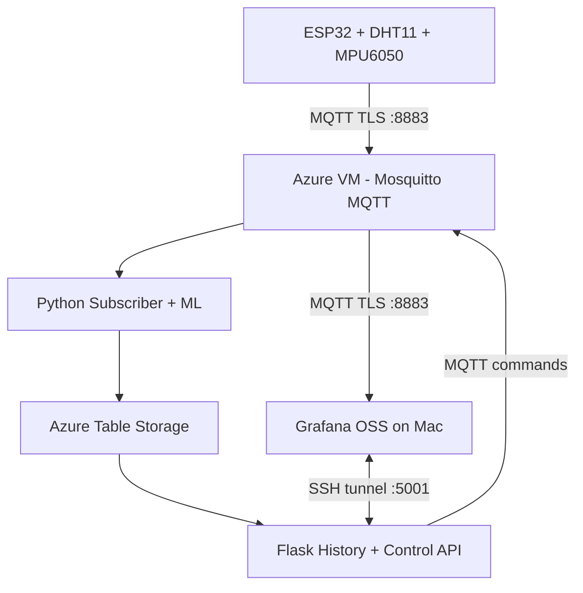

# ⚙️ IoT Equipment Condition Monitoring System

**ESP32 • MQTT • Python • Docker • Azure • Machine Learning • Grafana**

An end-to-end IoT equipment monitoring prototype developed for SOFE 4610U at Ontario Tech University.

The system collects physical sensor readings, evaluates equipment conditions, processes data in Microsoft Azure, detects anomalies, stores historical records, and displays results through one Grafana dashboard.

## Features

- Real-time temperature, humidity and vibration monitoring
- Eight configurable equipment monitoring profiles
- NORMAL, WARNING and CRITICAL condition detection
- Local LEDs, buzzer and alarm acknowledgement button
- Secure MQTT communication with Azure using TLS
- Wi-Fi setup portal for connecting at different locations
- Isolation Forest machine learning anomaly detection
- Azure Table Storage for historical summaries and events
- Email notifications for equipment and connectivity changes
- Grafana dashboard for live data and historical analysis
- Authenticated remote profile and threshold configuration

## Architecture



### Deployment

The Azure Ubuntu VM runs three Docker services:

| Service | Purpose |
|---|---|
| Mosquitto | Authenticated MQTT broker |
| Subscriber | Telemetry, ML, storage and notifications |
| Flask API | Historical data and remote configuration |

The cloud deployment is defined in `compose.cloud.yaml`.

Grafana OSS runs locally on the Mac. There is no paid Grafana subscription or separate Grafana cloud service.

## Hardware

| Component | ESP32 GPIO |
|---|---|
| DHT11 temperature and humidity | 27 |
| MPU6050/MPU6500 SDA | 21 |
| MPU6050/MPU6500 SCL | 22 |
| Green LED | 25 |
| Yellow LED | 26 |
| Red LED | 33 |
| Active buzzer | 23 |
| Acknowledgement button | 13 |

Only one physical ESP32 device is used.

## Equipment Profiles

The operator can select MOTOR, PUMP, COMPRESSOR, FAN, CONDENSER, HEAT_EXCHANGER, AHU or CHILLER.

Each profile defines configurable thresholds for temperature, humidity and vibration.

Profiles represent monitoring configurations. They do not control physical industrial machinery.

## ESP32 Wi-Fi Configuration

Firmware:
`firmware/esp32/equipment_monitor/equipment_monitor.ino`

The ESP32 uses WiFiManager to configure its wireless network.

When needed:

1. Enter `W` in Arduino Serial Monitor at 115200 baud.
2. Connect to `EquipmentMonitor-Setup`.
3. Open `http://192.168.4.1`.
4. Select a Wi-Fi network and enter its password.
5. Save the configuration.

Manual switching between home Wi-Fi and an iPhone hotspot has been demonstrated.

Automatic switching between multiple saved Wi-Fi networks is not implemented.

The device connects to the same Azure MQTT broker regardless of the local network.

## MQTT

**Broker:** `iot-monitor-dp0912.northcentralus.cloudapp.azure.com`

**Remote port:** `8883` with TLS

**Internal Docker port:** `1883`

**Device ID:** `ESP32-001`

Main MQTT topics use the prefix `equipment/ESP32-001/`.

Topics include telemetry, status, sensor_health, config, control_status, commands, command_ack, alerts, connectivity and ml.

## Machine Learning

The backend uses Scikit-learn Isolation Forest to identify unusual patterns in aggregated sensor measurements.

Inputs include average temperature, average humidity, average vibration and maximum vibration.

Results are published to MQTT and displayed in Grafana.

The trained model is stored in `ml/models/`.

## Azure Storage

Azure Table Storage stores:

- `SUMMARY`: Aggregated sensor measurements and statistics
- `EVENT`: Equipment condition changes and monitoring events

The Flask API provides:

- `/api/history/summary`
- `/api/history/events`

## Grafana Dashboard


*Illustrative dashboard overview.*

One Grafana dashboard provides:

- Live sensor readings and equipment condition
- Connectivity and sensor health
- ML anomaly results
- Historical Azure sensor trends and alerts
- Operator sign-in and threshold configuration
- Equipment profile selection and acknowledgements

Grafana runs locally at:

`http://localhost:3000`

Live MQTT data comes directly from the Azure broker.

Historical data and operator controls use the Azure Flask API through an SSH tunnel.

Select **Last 15 minutes** for live monitoring. Zooming into older dates may temporarily cause live panels to display No data because Grafana uses a dashboard-wide time range.

Dashboard definition:
`dashboard/grafana/iot-equipment-live-dashboard.json`

## Notifications

Email notifications support WARNING, CRITICAL, RECOVERY, DEVICE OFFLINE and DEVICE ONLINE events.

SMS notifications are a possible future enhancement, not part of the implemented system.

## Project Structure

```text
IoT-Equipment-Condition-Monitoring-System/
├── README.md
├── compose.cloud.yaml
├── .env.example
├── requirements.txt
├── firmware/
│   └── esp32/equipment_monitor/
├── backend/
│   ├── mqtt/
│   ├── azure/
│   ├── api/
│   └── notifications/
├── ml/
│   ├── inference/
│   ├── training/
│   └── models/
├── docker/
├── dashboard/grafana/
├── docs/
└── hardware/
```

## Documentation

- [System Architecture](docs/architecture/system_architecture.md)
- [Operations Guide](docs/guides/02_OPERATIONS_GUIDE.md)
- [ESP32 Wiring](docs/wiring/esp32_wiring.md)
- [ESP32 Configuration Example](firmware/esp32/equipment_monitor/secrets.example.h)

## Security

- MQTT over TLS for remote clients
- Username/password authentication
- Private CA certificate verification
- Authenticated operator controls
- Localhost-bound Flask API
- SSH tunnel for remote API access
- Private credentials excluded from Git

The real `.env`, `secrets.h`, MQTT passwords and certificate private keys must never be committed.

## Limitations

This project is an educational IoT monitoring prototype, not a certified industrial safety or machinery-control system.

Sensor measurements and ML anomaly classifications are not calibrated industrial fault diagnoses.

---

**Ontario Tech University — SOFE 4610U**

*Real-time IoT monitoring from physical sensors to cloud analytics.*
