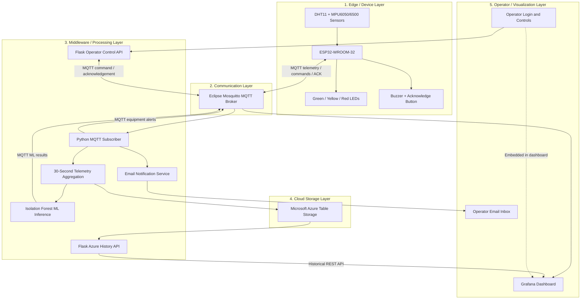

<div align="center">

# ⚙️ IoT Equipment Condition Monitoring System

### Intelligent Multi-Sensor Monitoring with Edge Computing, Cloud Integration & Machine Learning

**An end-to-end Industrial IoT prototype for real-time equipment condition monitoring, anomaly detection, cloud-based historical analytics, and remote operator configuration.**

<br>


<br>


**[Overview](#-project-overview) • [Architecture](#-system-architecture) • [Hardware](#-hardware-and-wiring) • [Dashboard](#-grafana-monitoring-dashboard) • [Installation](#-installation-and-setup) • [Testing](#-testing-and-validation)**

</div>

---

## 📌 Project Overview

The **IoT Equipment Condition Monitoring System** is a configurable, multi-sensor Internet of Things (IoT) prototype designed to demonstrate modern equipment monitoring using embedded hardware, MQTT communication, edge computing, cloud services, and machine learning.

The system continuously monitors three environmental and mechanical parameters:

- **Temperature:** Ambient temperature measured using a DHT11 sensor.
- **Humidity:** Relative humidity measured using the DHT11.
- **Vibration:** Dynamic acceleration RMS estimated using an MPU6050/MPU6500 accelerometer.

An **ESP32-WROOM-32** performs sensor acquisition, validates readings, evaluates configurable thresholds, and determines the equipment condition locally.

Measurements and device states are transmitted through a **Mosquitto MQTT broker**, enabling real-time Grafana visualization and processing by a Python backend.

The backend supports data aggregation, Azure Table Storage, equipment alerts, email notifications, and Isolation Forest-based anomaly detection.

### Project Objectives

1. Develop a functional end-to-end IoT monitoring pipeline.
2. Perform real-time sensor acquisition and edge-based condition classification.
3. Implement reliable MQTT communication between devices and software services.
4. Provide a professional operator dashboard with live and historical monitoring.
5. Support authenticated remote equipment-profile and threshold configuration.
6. Detect potentially abnormal sensor behaviour using machine learning.
7. Store historical summaries and events in Microsoft Azure.
8. Notify operators about abnormal conditions, recovery, and device connectivity changes.
9. Design the system for future expansion to multiple monitoring devices.

> **Scope:** This project monitors equipment conditions. It does not physically control motors, pumps, compressors, fans, chillers, or other industrial machinery.

---

## ✨ Key Features

| Category | Implemented Functionality |
|---|---|
| **Edge Monitoring** | ESP32-based temperature, humidity, and vibration monitoring |
| **Condition Classification** | NORMAL, WARNING, and CRITICAL states |
| **Local Indication** | Green, yellow, and red LEDs |
| **Audible Alarm** | Repeating buzzer alert for CRITICAL conditions |
| **Alarm Acknowledgement** | Physical push button silences the buzzer without clearing the condition |
| **Communication** | MQTT publish/subscribe through Mosquitto |
| **Equipment Profiles** | Eight selectable monitoring profiles with different thresholds |
| **Remote Configuration** | Authenticated operator controls for thresholds and profile selection |
| **Configuration Persistence** | ESP32 Preferences storage maintains confirmed settings after restart |
| **Visualization** | Grafana dashboards with live telemetry and operator status |
| **Cloud Storage** | Azure Table Storage for historical summaries and equipment events |
| **Historical Analytics** | Azure data retrieval through a local Flask API |
| **Machine Learning** | Isolation Forest anomaly detection on aggregated telemetry |
| **Notifications** | WARNING, CRITICAL, and RECOVERY emails identifying the equipment type |
| **Connectivity Monitoring** | Online/offline detection and optional connectivity notifications |
| **Sensor Diagnostics** | DHT11 and MPU validity monitoring |
| **Testing** | Automated structural tests and a hardware integration checklist |

---

## 🏗️ System Architecture

The system separates responsibilities across the **edge device, MQTT broker, Python middleware, cloud storage, and visualization layer**.

### End-to-End Architecture



### Architecture Layers

| Layer | Technology | Responsibility |
|---|---|---|
| Edge | ESP32, DHT11, MPU6050/MPU6500 | Measurements, validation, condition classification and local indicators |
| Communication | MQTT, Mosquitto | Device-to-service messaging and operator commands |
| Middleware | Python, Paho MQTT | Telemetry processing, aggregation, alerts and service integration |
| Machine Learning | Scikit-learn, Isolation Forest | Anomaly inference on aggregated sensor features |
| Cloud | Microsoft Azure Table Storage | Storage of historical summaries and condition events |
| API | Python Flask | Historical data access and authenticated configuration operations |
| Visualization | Grafana | Live telemetry, status panels, history and operator controls |
| Notification | SMTP | Email alerts and recovery notifications |

Detailed architecture documentation is available in [docs/architecture/system_architecture.md](docs/architecture/system_architecture.md).

---

## ⚙️ Hardware and Wiring

### Hardware Components

| Component | Purpose |
|---|---|
| ESP32-WROOM-32 DevKit | Main embedded controller and Wi-Fi-enabled edge device |
| DHT11 Sensor | Ambient temperature and relative humidity |
| MPU6050 / MPU6500 | Three-axis acceleration data for vibration RMS estimation |
| Green LED | NORMAL condition indicator |
| Yellow LED | WARNING condition indicator |
| Red LED | CRITICAL condition indicator |
| Active Buzzer | Audible alarm for CRITICAL conditions |
| Push Button | Physical acknowledgement and buzzer muting |
| Breadboard | Prototype circuit assembly |
| Jumper Wires | Electrical connections |
| Current-Limiting Resistors | LED protection |
| USB Cable | ESP32 programming and power |

### ESP32 GPIO Pin Configuration

| Device | ESP32 Pin | Function |
|---|---|---|
| DHT11 Data | GPIO 27 | Temperature and humidity |
| MPU SDA | GPIO 21 | I²C data |
| MPU SCL | GPIO 22 | I²C clock |
| Green LED | GPIO 25 | Normal indicator |
| Yellow LED | GPIO 26 | Warning indicator |
| Red LED | GPIO 33 | Critical indicator |
| Push Button | GPIO 13 | Alarm acknowledgement |
| Active Buzzer | GPIO 23 | Audible alarm |

The push button is connected between GPIO13 and GND using the ESP32's internal pull-up resistor.

The MPU communicates over I²C. All connected devices must use a suitable supply voltage and shared ground.

**Electrical note:** Only a GPIO-compatible low-current buzzer should be driven directly. A higher-current buzzer requires an appropriately rated transistor or driver circuit.

Full wiring instructions: [ESP32 Wiring Documentation](docs/wiring/esp32_wiring.md).

---

## 🧠 Edge-Based Equipment Condition Classification

The ESP32 processes sensor measurements locally rather than depending entirely on the cloud.

This allows the local indicators and buzzer to operate even when the Python backend or Azure service is unavailable.

### Equipment Condition States

| Condition | Meaning | Local Response |
|---|---|---|
| 🟢 **NORMAL** | Valid measurements are within configured limits | Green LED ON |
| 🟡 **WARNING** | A warning boundary is reached, or a required sensor reading is invalid | Yellow LED ON |
| 🔴 **CRITICAL** | A critical boundary is reached | Red LED ON and buzzer activated |

For temperature and humidity, both lower and upper thresholds are evaluated.

For vibration, upper thresholds are evaluated.

### Threshold Evaluation

For temperature and humidity:

- `value <= critical_low` → CRITICAL
- `value <= warning_low` → WARNING
- `value >= critical_high` → CRITICAL
- `value >= warning_high` → WARNING
- Otherwise → NORMAL

For vibration:

- `value >= critical_high` → CRITICAL
- `value >= warning_high` → WARNING
- Otherwise → NORMAL

The highest severity across valid sensor measurements determines the overall equipment condition.

An unavailable or invalid sensor reading also produces a warning indication.

### Local Alarm Acknowledgement

When the equipment enters CRITICAL:

1. The red LED turns ON.
2. The buzzer begins its repeating 200 ms ON / 800 ms OFF pattern.
3. The operator may press the physical acknowledgement button.
4. The buzzer becomes silent.
5. The equipment condition remains CRITICAL until sensor measurements change.

**Acknowledging an alarm is not equivalent to resolving the underlying abnormal condition.**

---

## 🏭 Configurable Equipment Monitoring Profiles

The ESP32 supports **eight selectable equipment profiles**.

Each profile defines demonstration thresholds for temperature, humidity, and vibration.

| Equipment Profile | Monitoring Context |
|---|---|
| `MOTOR` | Vibration and ambient conditions |
| `PUMP` | Vibration and ambient conditions |
| `COMPRESSOR` | Vibration and environmental changes |
| `FAN` | Vibration and airflow-related ambient conditions |
| `CONDENSER` | Ambient monitoring context |
| `HEAT_EXCHANGER` | Ambient monitoring context |
| `AHU` | Air-handling and vibration monitoring |
| `CHILLER` | Ambient and vibration monitoring |

**Important:** These are selectable software profiles. The current prototype has one ESP32 sensor assembly, not eight simultaneously connected machines.

The operator selects a profile in Grafana. After authenticated submission, the ESP32 applies that profile and publishes its confirmed thresholds.

Users may also adjust thresholds individually.

Validated settings are saved in the ESP32's non-volatile Preferences storage and restored after restart.

> The included threshold values are educational demonstration parameters, not manufacturer-approved operating or safety limits.

---

## 📡 MQTT Communication

MQTT provides lightweight publish/subscribe messaging between the ESP32, Python backend and Grafana.

### MQTT Topic Structure

The current device identifier is `ESP32-001`.

| MQTT Topic | Purpose |
|---|---|
| `equipment/ESP32-001/telemetry` | Sensor measurements and current equipment condition |
| `equipment/ESP32-001/status` | Device ONLINE / OFFLINE status |
| `equipment/ESP32-001/config` | Current ESP32-confirmed profile and thresholds |
| `equipment/ESP32-001/sensor_health` | Sensor availability and fault diagnostics |
| `equipment/ESP32-001/control_status` | Equipment condition and audible alarm state |
| `equipment/ESP32-001/commands` | Incoming operator commands |
| `equipment/ESP32-001/command_ack` | Command acknowledgement |
| `equipment/ESP32-001/alerts` | Equipment WARNING / CRITICAL / RECOVERY events |
| `equipment/ESP32-001/connectivity` | Backend device-connectivity status |
| `equipment/ESP32-001/ml` | Machine-learning anomaly results |

The ESP32 publishes telemetry approximately every **2.5 seconds**.

The backend aggregates valid readings into approximately **30-second windows** for historical processing and ML inference.

### Example Telemetry Payload

```json
{
  "device_id": "ESP32-001",
  "temperature": 26.7,
  "humidity": 63.0,
  "vibration": 0.052,
  "condition": "NORMAL",
  "profile": "MOTOR",
  "dht_valid": true,
  "vibration_valid": true,
  "sensor_fault": false
}
```

The validity fields help the backend distinguish actual measurements from missing sensor data.

### MQTT Command Workflow

```text
Operator changes settings in Grafana
                |
                v
       Authenticated Flask API
                |
                v
      MQTT command published
                |
                v
         ESP32 validates
                |
                v
     Settings applied and saved
                |
                v
     MQTT command acknowledgement
                |
                v
        Operator receives result
```

Supported commands include:

- `GET_CONFIG`
- `SET_PROFILE`
- `SET_THRESHOLDS`
- `ACK_ALARM`

Commands use identifiers and expiration timestamps to reduce accidental duplicate or stale operations.

---

## 📊 Grafana Monitoring Dashboard

Grafana provides a single interface for live monitoring, alert visibility, ML results, historical analysis and authorized equipment configuration.

**Dashboard export:**

[View Grafana Dashboard JSON](dashboard/grafana/iot-equipment-live-dashboard.json)

### Live Monitoring

| Dashboard Component | Description |
|---|---|
| Device Status | Latest online/offline indication |
| Temperature | Live ambient temperature |
| Humidity | Live relative humidity |
| Vibration | Current vibration RMS |
| Equipment Condition | NORMAL / WARNING / CRITICAL |
| Live Sensor Trends | Streaming temperature, humidity and vibration |
| Latest Readings | Recent measurements and equipment condition |
| Equipment Alerts | Warning, critical and recovery events |
| Device Connectivity | Connectivity information derived by the backend |

### Diagnostics and Intelligence

| Component | Description |
|---|---|
| Sensor Health | Whether DHT11 and MPU measurements are valid |
| Equipment & Alarm | Current profile, condition and audible alarm status |
| Confirmed Thresholds | Actual thresholds accepted by the ESP32 |
| ML Anomaly Status | Isolation Forest result and anomaly score |

### Historical Monitoring

- Azure historical sensor trends.
- Historical equipment condition events.
- Date-range filtering through Grafana's dashboard time picker.

The two Azure historical panels follow the selected dashboard date range. Live MQTT panels use their own recent-data windows.

### Operator Configuration

Grafana also provides:

- Operator sign-in.
- Temperature threshold configuration.
- Humidity threshold configuration.
- Vibration threshold configuration.
- Equipment profile selection.
- ESP32-confirmed command results.

The dashboard uses a local authenticated Flask API for configuration updates.

**The monitoring system currently includes 22 Grafana panels.**

The current dashboard layout prioritizes readable measurements and operational status rather than exposing unnecessary raw diagnostic metadata.

### Required Grafana Integrations

- Grafana MQTT datasource.
- Grafana Infinity datasource.
- Business Forms plugin.
- Dynamic Text plugin.

Local datasource identifiers may need to be reassigned when importing the JSON into another Grafana installation.

---

## ☁️ Microsoft Azure Integration

The cloud layer uses **Microsoft Azure Table Storage** for historical monitoring records.

The Python backend processes incoming MQTT telemetry and writes aggregated measurements and condition events.

### Historical Record Types

| Record | Purpose |
|---|---|
| `SUMMARY` | Aggregated equipment sensor readings |
| `EVENT` | Equipment condition transitions and historical alerts |

### Data Flow

```text
ESP32
  |
  v
Mosquitto MQTT
  |
  v
Python Subscriber
  |
  +----> 30-second sensor aggregation
  |               |
  |               v
  |        Azure Table Storage
  |               |
  |               v
  |        Flask History API
  |               |
  |               v
  |        Grafana Historical Panels
  |
  +----> Equipment condition events
```

### Historical API Endpoints

The local Flask service provides historical data endpoints:

```text
GET /api/history/summary
GET /api/history/events
```

Example requests:

```text
http://127.0.0.1:5001/api/history/summary
http://127.0.0.1:5001/api/history/events
```

Grafana supplies date-range parameters when requesting historical data.

Azure storage is configurable and requires valid credentials and storage resources.

**Azure history is different from the live MQTT stream:** MQTT delivers current data, while Azure provides persistent historical information.

---

## 🤖 AI/ML-Based Anomaly Detection

Machine learning provides an additional analysis layer beyond fixed warning and critical thresholds.

The current implementation uses the **Isolation Forest** algorithm through Scikit-learn.

### Processing Pipeline

```text
MQTT Sensor Telemetry
         |
         v
Sensor Validation
         |
         v
30-Second Aggregation
         |
         v
Feature Preparation
         |
         v
Isolation Forest Model
         |
         v
Normal / Anomaly Classification
         |
         v
MQTT ML Result
         |
         v
Grafana ML Anomaly Status
```

### Machine Learning Components

| File | Responsibility |
|---|---|
| `ml/training/train_model.py` | Model training workflow |
| `ml/training/inspect_data.py` | Dataset exploration |
| `ml/models/isolation_forest.joblib` | Serialized model artifact |
| `ml/inference/predict_anomaly.py` | Model inference |
| `ml/inference/test_model.py` | Inference testing |

Grafana displays the ML result and anomaly score.

**ML anomaly detection supplements threshold-based monitoring.** An ML anomaly does not automatically mean that equipment has failed, and this prototype is not a validated predictive-maintenance solution for real industrial machinery.

---

## 📧 Automated Email Notifications

The Python backend includes an email notification service using SMTP.

Notifications are queued so email delivery does not block normal MQTT processing.

### Equipment Alert Types

| Alert | Trigger |
|---|---|
| ⚠️ WARNING | Equipment transitions into WARNING |
| 🚨 CRITICAL | Equipment transitions into CRITICAL |
| ✅ RECOVERY | Equipment returns to NORMAL |
| 📡 OFFLINE | Confirmed device connectivity loss |
| 🔗 ONLINE | Device reconnects after an offline condition |

Equipment-condition emails identify the selected profile.

### Example Email

```text
Subject: RECOVERY - MOTOR - Equipment Back to Normal

IoT EQUIPMENT CONDITION MONITORING SYSTEM
-----------------------------------------

Alert: RECOVERY
Equipment: MOTOR
Device: ESP32-001
Previous Condition: CRITICAL
Current Condition: NORMAL

Temperature: 26.7 C
Humidity: 63.0 %
Vibration: 0.2131 RMS
Time: 2026-11-04T15:37:12-05:00
```

Selecting FAN, PUMP, COMPRESSOR, CHILLER or another profile automatically changes the equipment name included in subsequent equipment-condition emails.

Email notifications require an enabled and correctly configured SMTP service.

---

## 🔐 Security and Operator Access

The prototype incorporates several protections for remote configuration.

### Implemented Controls

- Environment-based credential configuration.
- Authenticated operator login through Flask.
- Session-based authorization.
- CSRF protection on configuration requests.
- Command identifiers.
- Command expiration checks.
- Duplicate-command rejection on the ESP32.
- Explicit acknowledgement of applied or rejected commands.
- Non-volatile persistence of accepted settings.
- Local API binding to `127.0.0.1`.

### Security Limitations

This is a local educational prototype.

Do not expose the Flask control API or unauthenticated MQTT broker to the public Internet.

For production use, additional safeguards would include:

- MQTT over TLS with appropriate certificate validation.
- Strong per-device identities and access-control policies.
- HTTPS and a production-ready API deployment.
- Centralized authentication and audit logging.
- Network segmentation and secure credential rotation.
- Device provisioning and lifecycle management.
- Additional resilience and safety validation.

Never commit `.env`, `secrets.h`, SMTP passwords, Azure credentials, or other private configuration files.

---

## 🛠️ Technology Stack

| Area | Technologies |
|---|---|
| Microcontroller | ESP32-WROOM-32 |
| Embedded Programming | Arduino C++ |
| Sensors | DHT11, MPU6050/MPU6500 |
| IoT Protocol | MQTT |
| MQTT Broker | Eclipse Mosquitto |
| Backend | Python |
| MQTT Client | Paho MQTT |
| Cloud | Microsoft Azure |
| Cloud Database | Azure Table Storage |
| REST API | Flask |
| Visualization | Grafana |
| Machine Learning | Scikit-learn, Isolation Forest |
| Notifications | SMTP |
| Development Tools | VS Code, Arduino IDE, Git, GitHub |

---

## 📂 Repository Structure

```text
IoT-Equipment-Condition-Monitoring-System/
│
├── README.md
├── requirements.txt
├── .env.example
├── .gitignore
│
├── firmware/
│   └── esp32/
│       └── equipment_monitor/
│           └── equipment_monitor.ino
│
├── hardware/
│   └── components.md
│
├── backend/
│   ├── api/
│   │   └── control_api.py
│   │
│   ├── mqtt/
│   │   ├── subscriber.py
│   │   └── telemetry_aggregator.py
│   │
│   ├── azure/
│   │   ├── storage.py
│   │   ├── history_api.py
│   │   ├── query_history.py
│   │   └── log_analytics.py
│   │
│   └── notifications/
│       └── email_notifier.py
│
├── ml/
│   ├── training/
│   │   ├── train_model.py
│   │   └── inspect_data.py
│   │
│   ├── inference/
│   │   ├── predict_anomaly.py
│   │   └── test_model.py
│   │
│   └── models/
│       └── isolation_forest.joblib
│
├── dashboard/
│   └── grafana/
│       └── iot-equipment-live-dashboard.json
│
├── docs/
│   ├── architecture/
│   │   └── system_architecture.md
│   │
│   ├── wiring/
│   │   └── esp32_wiring.md
│   │
│   └── testing/
│       └── current_validation.md
│
└── tests/
    └── test_monitoring_rebuild_contract.py
```

Private configuration files and the local `.venv` are intentionally excluded from Git.

---

## 🚀 Installation and Setup

### Prerequisites

- ESP32 development board.
- DHT11 and MPU6050/MPU6500 sensors.
- LEDs, suitable buzzer, button, resistors and wiring.
- Arduino IDE with ESP32 board support.
- Python 3.
- Eclipse Mosquitto broker.
- Grafana with the required datasource and panel plugins.
- Microsoft Azure Storage account for cloud persistence.
- Optional SMTP account for email notifications.

### 1. Clone the Repository

```bash
git clone https://github.com/dp0912/IoT-Equipment-Condition-Monitoring-System.git

cd IoT-Equipment-Condition-Monitoring-System
```

### 2. Create a Python Virtual Environment

On macOS or Linux:

```bash
python3 -m venv .venv

source .venv/bin/activate

python -m pip install --upgrade pip

python -m pip install -r requirements.txt
```

### 3. Configure Environment Variables

Create your local `.env` file:

```bash
cp .env.example .env
```

Edit `.env` and configure your own settings.

Example variable names:

```dotenv
MQTT_HOST=127.0.0.1
MQTT_PORT=1883
MQTT_USERNAME=esp32_monitor
MQTT_PASSWORD=YOUR_MQTT_PASSWORD

CONTROL_USERNAME=operator
CONTROL_PASSWORD=YOUR_STRONG_PASSWORD
CONTROL_SESSION_SECRET=YOUR_RANDOM_SESSION_SECRET

CONTROL_ALLOWED_ORIGINS=http://localhost:3000,http://127.0.0.1:3000

EMAIL_ENABLED=false
SMTP_HOST=smtp.gmail.com
SMTP_PORT=587
SMTP_USER=
SMTP_APP_PASSWORD=
ALERT_EMAIL_TO=
```

Configure Azure using the environment variables required by `backend/azure/storage.py` and your Azure resources.

Do not upload real credentials to GitHub.

### 4. Configure and Upload ESP32 Firmware

Open the following sketch in Arduino IDE:

```text
firmware/esp32/equipment_monitor/equipment_monitor.ino
```

Install the required Arduino libraries:

- ESP32 Arduino board package.
- DHT sensor library.
- PubSubClient.
- ArduinoJson version 7.

Create a local `secrets.h` in the same sketch folder with the following definitions:

```cpp
#pragma once

#define WIFI_SSID "YOUR_WIFI_SSID"
#define WIFI_PASSWORD "YOUR_WIFI_PASSWORD"

#define MQTT_SERVER "YOUR_BROKER_IP"
#define MQTT_PORT 1883

#define MQTT_USERNAME "YOUR_MQTT_USERNAME"
#define MQTT_PASSWORD "YOUR_MQTT_PASSWORD"
```

Select **ESP32 Dev Module**, choose the correct USB port, verify the sketch, and upload.

`secrets.h` must remain private and should not be committed.

### 5. Start the MQTT Broker

Run your configured Mosquitto service.

For a Homebrew-managed local installation, one common startup command is:

```bash
brew services start mosquitto
```

The broker must be configured with the authentication settings expected by the ESP32 and Python subscriber.

### 6. Start the Python MQTT Subscriber

From the repository root, with the virtual environment active:

```bash
python backend/mqtt/subscriber.py
```

The subscriber processes telemetry, equipment events, ML inference, and configured Azure/email integration.

### 7. Start the Flask History and Control API

Open another terminal in the project root, activate the virtual environment, then run:

```bash
python backend/azure/history_api.py
```

The local service uses:

```text
http://127.0.0.1:5001
```

This process provides the Azure history API and integrates the authenticated operator control API.

### 8. Start Grafana

For a Homebrew-managed installation:

```bash
brew services start grafana
```

Open:

```text
http://localhost:3000
```

Import:

```text
dashboard/grafana/iot-equipment-live-dashboard.json
```

Configure the MQTT and Infinity data sources and ensure the required panel plugins are installed.

The exported dashboard contains datasource references from the development environment; they may need to be updated on another system.

### 9. Verify the Dashboard

Confirm that:

- The ESP32 is connected to MQTT.
- Temperature, humidity, and vibration values are arriving.
- Sensor Health reports valid measurements.
- Equipment Condition changes when configured limits are crossed.
- Local LEDs follow the condition.
- Critical alarms activate the buzzer.
- The acknowledgement button silences the buzzer.
- Grafana operator login works.
- Profile and threshold updates receive ESP32 acknowledgements.
- Azure historical data loads when configured.
- ML results appear after aggregation.
- Email notifications work when enabled.

---

## 🧪 Testing and Validation

The repository contains automated structural checks and a live validation checklist.

### Run Automated Tests

```bash
python -m unittest discover -s tests -v
```

### Check Python Syntax

```bash
python -m compileall -q backend ml
```

### Validate Grafana JSON

```bash
python -m json.tool dashboard/grafana/iot-equipment-live-dashboard.json > /dev/null
```

### Current Validation Scope

The available automated tests check selected project contracts, including:

- Monitoring-only firmware definitions.
- Grafana dashboard structure.
- Equipment-specific notification support.

These checks do not replace end-to-end testing with real hardware and running services.

For integration-test procedures and completion status, see:

[Current Validation Checklist](docs/testing/current_validation.md)

### Recommended Integration Scenarios

| Test Scenario | Expected Result |
|---|---|
| Normal measurements | Green LED, NORMAL state |
| Warning threshold reached | Yellow LED, WARNING alert |
| Critical threshold reached | Red LED, repeating buzzer |
| Physical acknowledgement | Buzzer muted; CRITICAL state retained |
| Sensor disconnected | Sensor fault reported |
| Operator changes profile | ESP32 accepts and publishes confirmed profile |
| Operator updates thresholds | New limits saved and acknowledged |
| ESP32 restarted | Saved profile and limits restored |
| MQTT connection interrupted | Offline detection after applicable timeout |
| Equipment returns to normal | RECOVERY event |
| Azure integration enabled | Historical records accessible |
| ML aggregation completed | Anomaly result published |
| Email enabled | Correct equipment type included in email |

---

## 📈 Performance and Design Characteristics

| Property | Current Design |
|---|---|
| Edge sampling interval | Approximately 2.5 seconds |
| Aggregation window | Approximately 30 seconds |
| Device count | One ESP32 |
| Monitoring profiles | Eight selectable profiles |
| Equipment condition states | NORMAL, WARNING, CRITICAL |
| MQTT command confirmation | Explicit acknowledgements |
| Threshold persistence | ESP32 Preferences |
| Local audible alert | 200 ms ON / 800 ms OFF |
| Cloud history | Azure Table Storage |
| Anomaly detection | Isolation Forest |

Actual performance depends on sensor timing, broker availability, network conditions, backend load, and Azure connectivity. These are implementation characteristics rather than measured production benchmarks.

---

## 🔮 Future Improvements

The current architecture provides a foundation for future extensions.

### Multi-Device Monitoring

Support multiple ESP32 devices, each associated with a particular equipment instance.

Example identifiers:

```text
ESP32-001 -> MOTOR-01
ESP32-002 -> FAN-01
ESP32-003 -> FAN-02
ESP32-004 -> PUMP-01
ESP32-005 -> CHILLER-01
```

This would require extending the firmware configuration, MQTT routing, backend storage model, and Grafana dashboard to distinguish device and equipment IDs.

### Additional Enhancements

- MQTT over TLS and device-specific authentication.
- Secure remote device provisioning.
- More robust sensor-health diagnostics.
- Dedicated industrial vibration and temperature sensors.
- Equipment-specific machine-learning models.
- Improved anomaly interpretation and model evaluation.
- Alert deduplication, escalation and acknowledgement audit trails.
- SMS notifications for critical conditions.
- Automated deployment and CI/CD workflows.
- Containerized backend services.
- Enhanced cloud availability and fault recovery.
- Multi-device Grafana dashboards and fleet monitoring.
- More complete automated integration testing.

These features are potential extensions, not claims about the current implementation.

---

## ⚠️ Limitations

This system is an educational prototype.

- DHT11 readings reflect ambient conditions, not internal equipment temperatures.
- Vibration is estimated from a low-cost MEMS accelerometer rather than an industrial vibration instrument.
- Equipment profiles use demonstration thresholds.
- One ESP32 monitors one selected profile at a time.
- Cloud-dependent features require connectivity and properly configured services.
- ML outputs are experimental anomaly indicators.
- Local operator authentication is not a substitute for a production identity-management system.
- The system does not perform physical equipment shutdown or safety interlocking.

It must not be used as the sole protection mechanism for machinery or safety-critical equipment.

---

## 📚 Project Documentation

| Document | Description |
|---|---|
| [System Architecture](docs/architecture/system_architecture.md) | Current data flow and system components |
| [Hardware Components](hardware/components.md) | Physical parts used in the prototype |
| [ESP32 Wiring](docs/wiring/esp32_wiring.md) | GPIO assignments and electrical connections |
| [Grafana Dashboard](dashboard/grafana/iot-equipment-live-dashboard.json) | Importable dashboard configuration |
| [Current Validation](docs/testing/current_validation.md) | Hardware and software integration checklist |

---

## 🎓 Academic Information

**Course:** SOFE 4610U — Design of IoT

**Institution:** Ontario Tech University, Oshawa, Ontario, Canada

**Academic Year:** Fall 2026

**Project:** IoT-Based Configurable Multi-Sensor Equipment Condition Monitoring System with AI/ML Integration

This project demonstrates the practical integration of embedded systems, IoT communication, software engineering, cloud services, data analytics, security-conscious configuration, and machine learning.

---

## 👨‍💻 Developer

**Dhruvin Patel**

Software Engineering — Ontario Tech University

**GitHub:** [github.com/dp0912](https://github.com/dp0912)

**Repository:** [IoT Equipment Condition Monitoring System](https://github.com/dp0912/IoT-Equipment-Condition-Monitoring-System)

---

<div align="center">

### Built with ESP32, Python, MQTT, Microsoft Azure, Grafana & Machine Learning

**Connecting physical sensor data with intelligent monitoring and cloud-based decision support.**

⭐ If you find this project useful, consider starring the repository.

</div>
