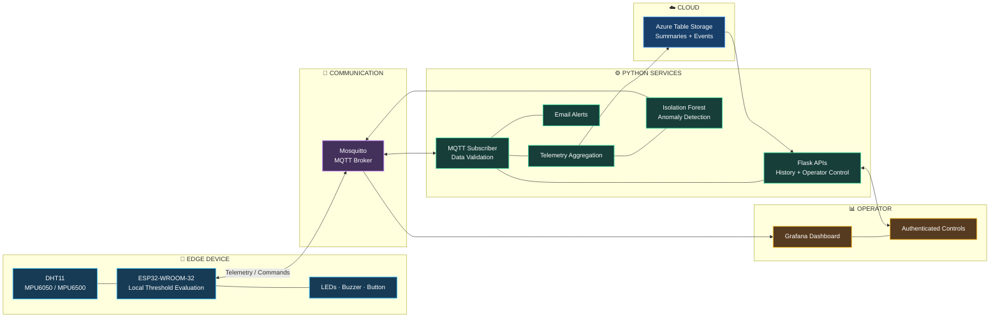

<div align="center">

# ⚙️ IoT Equipment Condition Monitoring System

### Smart Industrial IoT Monitoring with ESP32, Azure, Grafana & Machine Learning

**A configurable end-to-end IoT system for real-time equipment monitoring, anomaly detection, cloud analytics, and intelligent alerting.**


**[Architecture](#-system-architecture) · [Dashboard](#-live-monitoring-dashboard) · [Features](#-key-features) · [Setup](#-quick-start)**

</div>

---

## 📖 Overview

The **IoT Equipment Condition Monitoring System** is an Industrial IoT prototype developed for SOFE 4610U — Design of IoT at Ontario Tech University.

It combines **embedded sensing, MQTT messaging, Python processing, Microsoft Azure, Grafana visualization, and machine learning** to monitor equipment conditions and provide actionable alerts.

An ESP32 continuously collects temperature, humidity, and vibration measurements, evaluates configurable thresholds locally, and publishes live telemetry through MQTT.

The Python backend handles cloud storage, anomaly detection, equipment alerts, and remote operator commands.

The system supports **eight configurable equipment profiles**:

`MOTOR` · `PUMP` · `COMPRESSOR` · `FAN` · `CONDENSER` · `HEAT_EXCHANGER` · `AHU` · `CHILLER`

> The current prototype uses one ESP32 with selectable equipment profiles. It monitors simulated equipment contexts rather than physically controlling eight machines.

---

## 🏗️ System Architecture

A layered architecture separates edge processing, communication, backend services, cloud storage, and operator visualization.



**Edge:** Real-time sensor processing and local alarms.  
**MQTT:** Lightweight bidirectional device communication.  
**Backend:** Processing, aggregation, notifications, ML, and authenticated APIs.  
**Azure:** Persistent historical telemetry and event storage.  
**Grafana:** Live monitoring, historical analysis, and operator configuration.

---

## ✨ Key Features

| Feature | Description |
|---|---|
| 📡 **Real-Time Monitoring** | Temperature, humidity, and vibration telemetry every ~2.5 seconds |
| 🚦 **Condition Detection** | NORMAL, WARNING, and CRITICAL classification at the ESP32 |
| 🔔 **Local Alerts** | Three status LEDs, audible buzzer, and physical acknowledgement button |
| 🏭 **Equipment Profiles** | Eight selectable profiles with configurable sensor thresholds |
| 🎛️ **Operator Controls** | Authenticated profile and threshold updates with ESP32 acknowledgement |
| ☁️ **Cloud Storage** | Azure Table Storage for historical summaries and condition events |
| 🤖 **AI/ML Detection** | Isolation Forest inference on aggregated sensor readings |
| 📧 **Email Notifications** | WARNING, CRITICAL, RECOVERY, and connectivity notifications |
| 📊 **Grafana Visualization** | Live dashboard, sensor health, alerts, ML results, and Azure history |
| 💾 **Persistent Settings** | Active thresholds and profile survive ESP32 restarts |

---

## 📊 Live Monitoring Dashboard

The Grafana dashboard provides a single operator interface for monitoring and controlling the system.

<div align="center">


<sub>Grafana — Live MQTT telemetry, equipment condition, alerts, and historical monitoring</sub>

</div>

### Dashboard Capabilities

| Monitoring | Analytics & Control |
|---|---|
| Live temperature, humidity and vibration | AI/ML anomaly status |
| Equipment condition and connectivity | Azure historical sensor trends |
| Latest sensor readings | Historical equipment alerts |
| Sensor health and fault detection | Confirmed threshold configuration |
| Equipment WARNING / CRITICAL alerts | Operator login and equipment profile selection |
| Audible alarm acknowledgement status | Remote threshold updates |

The dashboard uses **Grafana MQTT and Infinity data sources**, along with Business Forms and Dynamic Text plugins.

**[View Dashboard Configuration](dashboard/grafana/iot-equipment-live-dashboard.json)**

---

## 🔧 Hardware Configuration

| Component | ESP32 GPIO | Purpose |
|---|---|---|
| DHT11 | 27 | Temperature and humidity |
| MPU6050/MPU6500 SDA | 21 | I²C data |
| MPU6050/MPU6500 SCL | 22 | I²C clock |
| Green LED | 25 | NORMAL |
| Yellow LED | 26 | WARNING |
| Red LED | 33 | CRITICAL |
| Push Button | 13 | Alarm acknowledgement |
| Active Buzzer | 23 | Critical audible alert |

The ESP32 evaluates sensor readings locally and activates the corresponding status LED.

During a CRITICAL condition, the buzzer repeats a **200 ms ON / 800 ms OFF** pattern. The physical button silences the buzzer without changing the detected equipment condition.

> The active buzzer must be electrically compatible with ESP32 GPIO output or connected through a suitable driver circuit.

**[Full Wiring Documentation](docs/wiring/esp32_wiring.md)**

---

## 📡 MQTT Communication

The monitoring device publishes data using the identifier `ESP32-001`.

| Topic | Purpose |
|---|---|
| `equipment/ESP32-001/telemetry` | Live sensor measurements |
| `equipment/ESP32-001/status` | Online/offline state |
| `equipment/ESP32-001/config` | Confirmed thresholds and profile |
| `equipment/ESP32-001/sensor_health` | Sensor diagnostics |
| `equipment/ESP32-001/control_status` | Condition and buzzer state |
| `equipment/ESP32-001/commands` | Operator commands |
| `equipment/ESP32-001/command_ack` | Command confirmations |
| `equipment/ESP32-001/alerts` | Equipment alerts |
| `equipment/ESP32-001/ml` | Machine-learning results |

### Example Telemetry

```json
{
  "device_id": "ESP32-001",
  "profile": "MOTOR",
  "temperature": 26.7,
  "humidity": 63.0,
  "vibration": 0.052,
  "condition": "NORMAL",
  "dht_valid": true,
  "vibration_valid": true,
  "sensor_fault": false
}
```

Sensor validity fields allow the backend to distinguish missing readings from normal measurements.

---

## 🤖 Machine Learning & Cloud Analytics

The backend aggregates valid sensor readings into approximately **30-second windows**.

**Isolation Forest** provides an additional anomaly-detection layer alongside the ESP32's rule-based threshold evaluation.

Aggregated measurements and equipment events are stored in **Azure Table Storage**. A Flask history API exposes this data to Grafana for date-range-based analysis.

Machine-learning predictions are published over MQTT for live visualization.

**ML outputs are experimental indicators rather than verified industrial fault diagnoses.**

---

## 📧 Intelligent Alerting

Operators receive equipment-specific notifications when monitored conditions change.

| Alert | Description |
|---|---|
| ⚠️ WARNING | Measurements enter warning range |
| 🚨 CRITICAL | Critical threshold reached |
| ✅ RECOVERY | Equipment returns to normal |
| 📶 OFFLINE / ONLINE | Device connectivity changes |

Example subject:

```text
RECOVERY - MOTOR - Equipment Back to Normal
```

Messages include the equipment profile, ESP32 device ID, sensor measurements, condition information, and timestamp.

The backend uses SMTP with configurable notification settings.

---

## 🚀 Quick Start

### 1. Clone the Repository

```bash
git clone https://github.com/dp0912/IoT-Equipment-Condition-Monitoring-System.git
cd IoT-Equipment-Condition-Monitoring-System
```

### 2. Configure Python

```bash
python3 -m venv .venv
source .venv/bin/activate
pip install -r requirements.txt
cp .env.example .env
```

Edit `.env` with your MQTT, Azure, operator authentication, and optional SMTP settings.

### 3. Upload ESP32 Firmware

Open:

```text
firmware/esp32/equipment_monitor/equipment_monitor.ino
```

Create a local `secrets.h` containing your Wi-Fi and MQTT credentials. Install the DHT, PubSubClient, and ArduinoJson libraries in Arduino IDE.

Select **ESP32 Dev Module** and upload the sketch.

### 4. Start Services

Start your configured Mosquitto broker:

```bash
brew services start mosquitto
```

Start the Python MQTT subscriber:

```bash
python backend/mqtt/subscriber.py
```

In another terminal, start the Flask history/control API:

```bash
python backend/azure/history_api.py
```

Start Grafana:

```bash
brew services start grafana
```

Open **http://localhost:3000** and import:

```text
dashboard/grafana/iot-equipment-live-dashboard.json
```

Configure the required data sources and plugins for your environment.

---

## 📁 Project Structure

```text
IoT-Equipment-Condition-Monitoring-System/
│
├── backend/
│   ├── api/                 # Operator control API
│   ├── mqtt/                # Subscriber and aggregation
│   ├── azure/               # Cloud storage and history
│   └── notifications/       # Email alerting
│
├── firmware/
│   └── esp32/               # ESP32 Arduino firmware
│
├── dashboard/
│   └── grafana/             # Dashboard JSON export
│
├── ml/
│   ├── training/            # Isolation Forest training
│   ├── inference/           # ML inference
│   └── models/              # Saved model
│
├── docs/                    # Architecture, wiring, testing
├── hardware/                # Component documentation
├── tests/                   # Automated checks
│
├── .env.example
├── requirements.txt
└── README.md
```

---

## 🧪 Testing & Validation

The repository includes structural checks for firmware functionality, dashboard integrity, and equipment-specific alerts.

```bash
python -m unittest discover -s tests -v
```

Additional integration tests cover sensor monitoring, threshold configuration, buzzer acknowledgement, MQTT connectivity, Azure history, and notifications.

**[Validation Documentation](docs/testing/current_validation.md)**

The system is a functional educational prototype under integration testing. It is not a safety-certified industrial monitoring or shutdown system.

---

## 🔮 Future Enhancements

- Multi-ESP32 deployment with equipment IDs such as `FAN-01`, `FAN-02`, and `MOTOR-01`.
- MQTT over TLS and stronger device authentication.
- Dedicated industrial-grade sensors and calibrated thresholds.
- Equipment-specific ML models and improved fault diagnostics.
- SMS notifications and alert escalation.
- Containerized services and automated CI/CD deployment.
- Fleet-level Grafana monitoring and cloud scalability.

---

## 👨‍💻 Developer

**Dhruvin Patel**  
Software Engineering — Ontario Tech University  
SOFE 4610U — Design of IoT | Fall 2026

**GitHub:** [github.com/dp0912](https://github.com/dp0912)

<div align="center">

---

### Built with ESP32 · Python · MQTT · Microsoft Azure · Grafana · Scikit-learn

*Transforming real-time sensor data into actionable equipment insights.*

</div>
