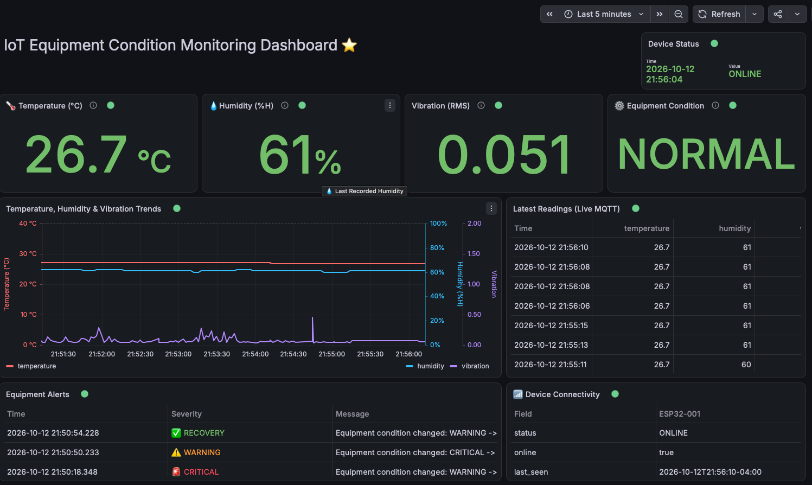

# IoT-Based Configurable Multi-Sensor Equipment Condition Monitoring System

### Real-Time Industrial Equipment Monitoring Using ESP32, MQTT, Python, Microsoft Azure, and Grafana

**Course:** SOFE 4610U — Design & Analysis of IoT  
**University:** Ontario Tech University  
**Academic Term:** Fall 2026  
**Project Status:** Active Development — Working Hardware-to-Cloud Prototype

---

## 1. Project Overview

The **IoT-Based Configurable Multi-Sensor Equipment Condition Monitoring System** is an Internet of Things (IoT) project designed to monitor equipment operating conditions through physical sensors, real-time data processing, cloud storage, and interactive visualization.

The project uses a DC motor and fan to represent rotating industrial equipment. An ESP32 microcontroller collects environmental and vibration measurements, evaluates operating conditions against configurable thresholds, and controls local indicators and equipment operation.

Sensor telemetry is transmitted over Wi-Fi using the MQTT protocol to a local Mosquitto broker. A Python backend processes incoming readings, detects changes in equipment condition, calculates statistical summaries, and integrates with Microsoft Azure for data storage and analysis.

A Grafana dashboard provides real-time monitoring of sensor readings, equipment conditions, alerts, and device connectivity.

The system is being developed incrementally, with AI/ML-based anomaly detection and remote notifications planned for later phases.

### Project Objectives

- Monitor equipment temperature, humidity, and vibration.
- Detect abnormal operating conditions using configurable thresholds.
- Classify equipment conditions as NORMAL, WARNING, or CRITICAL.
- Provide immediate local visual and audible alerts.
- Control a demonstration motor through safety-oriented software interlocks.
- Transmit sensor measurements over Wi-Fi using MQTT.
- Process and validate sensor telemetry using Python.
- Store statistical summaries and condition-change events in Microsoft Azure.
- Visualize real-time equipment data using Grafana.
- Extend the prototype with AI/ML-based anomaly detection and remote notifications.

---

## 2. Live Grafana Dashboard

The project includes a Grafana dashboard for monitoring live telemetry published by the ESP32 and processed by the MQTT backend.



### Dashboard Features

| Dashboard Component | Description                                                               |
| ------------------- | ------------------------------------------------------------------------- |
| Device Status       | Displays the monitored ESP32 device's connection status                   |
| Temperature         | Shows the latest temperature reading in degrees Celsius                   |
| Humidity            | Displays current relative humidity                                        |
| Vibration RMS       | Displays the current vibration measurement                                |
| Equipment Condition | Identifies NORMAL, WARNING, or CRITICAL operation                         |
| Temperature Trend   | Visualizes incoming temperature measurements                              |
| Humidity Trend      | Visualizes incoming humidity measurements                                 |
| Vibration Trend     | Visualizes incoming vibration measurements                                |
| Latest Readings     | Displays recent MQTT telemetry                                            |
| Equipment Alerts    | Displays condition transitions, including WARNING, CRITICAL, and RECOVERY |
| Device Connectivity | Displays connectivity information from the Python monitoring service      |

### Grafana Dashboard Configuration

The dashboard's exported JSON configuration is included in the repository:

[View Grafana Dashboard JSON](dashboard/grafana/iot-equipment-live-dashboard.json)

The dashboard was developed using **Grafana 13.2.3** and the Grafana MQTT datasource plugin.

**Note:** The screenshot represents a captured dashboard state. GitHub stores the screenshot and dashboard configuration but does not host the live monitoring service. Real-time visualization requires Grafana, the MQTT broker, and the ESP32 to be running.

MQTT-based dashboard readings are collected while connected; they are not a substitute for persistent historical storage.

---

## 3. System Architecture

The system follows an edge-to-cloud architecture in which the ESP32 performs local sensing and equipment control while backend and cloud services provide data processing, storage, and monitoring.

```text
                   PHYSICAL EQUIPMENT
                   DC Motor + Fan
                          |
                          v
                  +----------------+
                  |      ESP32     |
                  |                |
                  | DHT11          |
                  | MPU6500        |
                  | Thresholds     |
                  | Motor Control  |
                  +----------------+
                          |
             +------------+------------+
             |                         |
             v                         v
     LOCAL MONITORING             Wi-Fi / MQTT
                                 |
     LCD1602 Display             v
     Green/Yellow/Red LEDs  +-------------------+
     Active Buzzer          | Mosquitto Broker  |
     IR Remote              | Local Mac / LAN   |
     Push Button            +-------------------+
     Motor Interlocks               |
                                    |
                      +-------------+-------------+
                      |                           |
                      v                           v
             +------------------+        +------------------+
             | Python MQTT      |        | Grafana          |
             | Subscriber       |        | MQTT Datasource  |
             |                  |        |                  |
             | Validation       |        | Live Sensor Data |
             | Event Detection  |        | Trends           |
             | Aggregation      |        | Alerts           |
             | Connectivity     |------->| Connectivity     |
             +------------------+        +------------------+
                      |
              +-------+-------+
              |               |
              v               v
    +----------------+  +-------------------+
    | Azure Table    |  | Azure Monitor     |
    | Storage        |  | Log Analytics     |
    |                |  |                   |
    | SUMMARY        |  | Optional Logs     |
    | EVENT          |  | Ingestion         |
    +----------------+  +-------------------+

                 FUTURE DEVELOPMENT
                          |
                          v
               AI/ML Anomaly Detection
               Email / SMS Notifications
               Advanced Historical Analysis
```

### Edge Processing

The ESP32 is responsible for:

- Acquiring sensor measurements.
- Evaluating warning and critical thresholds.
- Maintaining operating modes.
- Driving LEDs, buzzer, and LCD.
- Managing local motor control and software STOP.
- Publishing telemetry through MQTT.
- Maintaining Wi-Fi and MQTT connectivity.

### Backend Processing

The Python backend handles:

- MQTT subscription and message processing.
- JSON validation and normalization.
- Equipment condition transition detection.
- Live alert generation.
- Connectivity monitoring.
- Statistical telemetry aggregation.
- Azure Table Storage uploads.
- Optional Azure Log Analytics ingestion.

### Cloud Processing and Storage

Microsoft Azure provides persistent records for monitoring and analysis.

Azure Table Storage stores aggregated measurements and equipment condition events. Azure Monitor Log Analytics can receive additional telemetry when explicitly enabled.

---

## 4. Technology Stack

| Category                | Technologies                                  |
| ----------------------- | --------------------------------------------- |
| Microcontroller         | ESP32 DevKit                                  |
| Embedded Programming    | C++, Arduino Framework                        |
| Sensors                 | DHT11, MPU6500                                |
| Motor Control           | L293D Motor Driver                            |
| Local Interface         | LCD1602, SN74HC595, LEDs, Buzzer, IR Remote   |
| Networking              | Wi-Fi                                         |
| Communication Protocol  | MQTT                                          |
| MQTT Broker             | Eclipse Mosquitto                             |
| Backend Language        | Python 3                                      |
| MQTT Python Library     | Paho MQTT                                     |
| Data Processing         | Python Statistics and Custom Aggregation      |
| Cloud Platform          | Microsoft Azure                               |
| Cloud Storage           | Azure Table Storage                           |
| Cloud Monitoring        | Azure Monitor, Log Analytics                  |
| Cloud Authentication    | Microsoft Entra ID for optional log ingestion |
| Visualization           | Grafana                                       |
| Grafana Integration     | MQTT Datasource Plugin                        |
| Development Environment | Arduino IDE, VS Code                          |
| Version Control         | Git and GitHub                                |
| Development Machine     | macOS / Apple Silicon                         |

---

## 5. Hardware Components

| Component                   | Purpose                                                         |
| --------------------------- | --------------------------------------------------------------- |
| ESP32 DevKit                | Main controller, local processing, Wi-Fi and MQTT communication |
| DHT11                       | Temperature and humidity sensing                                |
| MPU6500                     | Accelerometer-based vibration measurement                       |
| LCD1602                     | Local equipment monitoring display                              |
| SN74HC595                   | Shift register for LCD control                                  |
| L293D                       | DC motor driver                                                 |
| DC Motor with Fan           | Demonstration rotating equipment                                |
| IR Receiver                 | Accepts remote-control commands                                 |
| ELEGOO IR Remote            | Operating mode and threshold configuration                      |
| Push Button                 | Software emergency-stop/reset input                             |
| Green LED                   | Normal condition indication                                     |
| Yellow LED                  | Warning indication                                              |
| Red LED                     | Critical condition indication                                   |
| Active Buzzer               | Audible equipment alerts                                        |
| ELEGOO MB V2                | External 5V power distribution                                  |
| Breadboard and Jumper Wires | Circuit prototyping                                             |

Detailed hardware documentation:

- [Hardware Components](hardware/components.md)
- [ESP32 Wiring Documentation](docs/wiring/esp32_wiring.md)
- [Hardware Integration Test Results](docs/testing/hardware_test_results.md)

---

## 6. ESP32 GPIO Configuration

| Component             | ESP32 GPIO |
| --------------------- | ---------- |
| DHT11 Data            | GPIO27     |
| MPU6500 SDA           | GPIO21     |
| MPU6500 SCL           | GPIO22     |
| Green LED             | GPIO25     |
| Yellow LED            | GPIO26     |
| Red LED               | GPIO33     |
| Active Buzzer         | GPIO23     |
| IR Receiver           | GPIO32     |
| Push Button           | GPIO13     |
| L293D Enable          | GPIO4      |
| L293D IN1             | GPIO2      |
| L293D IN2             | GPIO15     |
| SN74HC595 Serial Data | GPIO18     |
| SN74HC595 Clock       | GPIO19     |
| SN74HC595 Latch       | GPIO5      |

**Electrical safety:** The motor must be driven through the motor driver rather than directly from ESP32 GPIO. The controller and motor-driver circuit require a common reference ground. The software STOP function is not a certified emergency-stop mechanism.

---

## 7. Equipment Condition Classification

The current ESP32 firmware evaluates measured sensor values against configurable warning and critical thresholds.

### Classification States

| Condition | Description                                  | Local Indication                                |
| --------- | -------------------------------------------- | ----------------------------------------------- |
| NORMAL    | Measurements remain within configured limits | Green LED                                       |
| WARNING   | A measurement reaches its warning range      | Yellow LED and warning indication               |
| CRITICAL  | A measurement reaches a critical range       | Red LED, audible indication and motor interlock |

### Default Sensor Thresholds

| Sensor      | Warning | Critical |
| ----------- | ------: | -------: |
| Temperature |    32°C |     40°C |
| Humidity    |     75% |      90% |
| Vibration   |     1.0 |      3.0 |

These are initial demonstration thresholds defined in the firmware and are adjustable during operation.

Threshold settings are stored in ESP32 nonvolatile Preferences storage so that configured values can persist across restarts.

### Operating Modes

The firmware supports:

- **AUTO:** Evaluate conditions using actual sensor measurements.
- **NORMAL:** Simulate normal operating conditions.
- **WARNING:** Simulate a warning condition.
- **CRITICAL:** Simulate a critical condition.

The simulated modes are used for testing the full monitoring and alert pipeline without requiring an actual equipment fault.

**Current detection method:** Configurable rule-based thresholds. A trained AI/ML anomaly-detection model has not yet been integrated.

---

## 8. Local Equipment Control

The ESP32 provides local monitoring and control through an LCD, IR remote, push button, LEDs, and buzzer.

### Motor Control

The demonstration DC motor is controlled through an L293D motor driver.

Current firmware behavior includes:

- Motor arming and disarming.
- Motor ON/OFF commands.
- Software STOP latching.
- Explicit STOP reset.
- Sensor-validity checks before starting the motor.
- Motor interlocks for critical operating conditions.

Motor operation is blocked when required safety conditions are not satisfied.

### Serial Monitor Commands

The ESP32 Serial Monitor operates at **115200 baud**.

| Command | Function                      |
| ------- | ----------------------------- |
| A       | Automatic monitoring mode     |
| N       | Simulate NORMAL condition     |
| W       | Simulate WARNING condition    |
| C       | Simulate CRITICAL condition   |
| P       | Print system status           |
| T       | Display configured thresholds |
| ?       | Display command help          |
| M       | Arm motor                     |
| F       | Turn fan ON                   |
| O       | Turn fan OFF                  |
| X       | Latch software STOP           |
| R       | Reset software STOP           |

The IR remote also supports LCD navigation, motor control, condition simulation, buzzer settings, and threshold adjustment.

---

## 9. MQTT Communication

MQTT is used for communication between the ESP32, Python backend, and Grafana dashboard.

The project uses a locally hosted Mosquitto broker with authenticated clients.

### Current MQTT Configuration

| Setting            | Value                      |
| ------------------ | -------------------------- |
| Protocol           | MQTT                       |
| Broker             | Eclipse Mosquitto          |
| Deployment         | Local development machine  |
| TCP Port           | 1883                       |
| Device ID          | ESP32-001                  |
| Telemetry Interval | Approximately 2 seconds    |
| Authentication     | MQTT username and password |

### MQTT Topics

| Topic                              | Purpose                                            |
| ---------------------------------- | -------------------------------------------------- |
| `equipment/ESP32-001/telemetry`    | ESP32 sensor measurements and operating conditions |
| `equipment/ESP32-001/status`       | ESP32 connection status                            |
| `equipment/ESP32-001/alerts`       | Backend-generated equipment condition alerts       |
| `equipment/ESP32-001/connectivity` | Backend-generated device connectivity information  |

### Example Telemetry Payload

```json
{
  "device_id": "ESP32-001",
  "temperature": 25.4,
  "humidity": 53.0,
  "vibration": 0.312,
  "condition": "NORMAL",
  "sensor_condition": "NORMAL",
  "mode": "NORMAL",
  "dht_valid": true,
  "vibration_valid": true,
  "motor_running": false,
  "motor_armed": false,
  "stop_latched": false,
  "uptime_ms": 30000
}
```

The payload includes sensor-validity flags and equipment state information so downstream processing can distinguish usable measurements from invalid readings.

The device status topic uses retained messages and MQTT Last Will behavior to support connection-status monitoring.

**Security note:** The current local MQTT connection uses TCP port 1883 without TLS. MQTT/TLS is a planned production-hardening improvement.

---

## 10. Python MQTT Backend

The main backend entry point is:

[`backend/mqtt/subscriber.py`](backend/mqtt/subscriber.py)

It uses the Paho MQTT library to connect to Mosquitto and receive ESP32 messages.

### Responsibilities

**Telemetry validation**

The subscriber checks:

- Required JSON fields.
- Device identifiers.
- Numeric sensor values.
- Non-finite and invalid values.
- Supported equipment conditions.

Invalid messages are rejected rather than processed as valid telemetry.

**Condition-change detection**

The backend tracks the previous condition for the device.

When a transition occurs, such as:

```text
NORMAL -> WARNING
WARNING -> CRITICAL
CRITICAL -> NORMAL
```

the backend creates an EVENT record for Azure Table Storage and publishes a live MQTT alert.

Recovery from a fault is represented using a RECOVERY alert.

**Connectivity monitoring**

The backend monitors the time elapsed since valid telemetry was last received.

- Connectivity checks run approximately every 2 seconds.
- A device is classified as OFFLINE after more than 10 seconds without valid telemetry.
- Retained connectivity messages allow Grafana to receive the latest published status.

**Azure upload retry**

The backend maintains an in-memory queue for pending Azure Table Storage writes.

Failed writes remain queued for retry, subject to queue limits.

This is not persistent offline storage; queued data may be lost if the backend process terminates.

---

## 11. Telemetry Aggregation

The telemetry aggregation module is:

[`backend/mqtt/telemetry_aggregator.py`](backend/mqtt/telemetry_aggregator.py)

Rather than writing every incoming sample to Azure Table Storage, the backend calculates statistical summaries for approximately 30-second windows.

For temperature, humidity, and vibration, the aggregator calculates:

| Statistic | Description                  |
| --------- | ---------------------------- |
| Average   | Mean of valid measurements   |
| Minimum   | Lowest valid measurement     |
| Maximum   | Highest valid measurement    |
| Latest    | Latest valid measurement     |
| Count     | Number of valid measurements |

Each summary also includes:

- Device identifier.
- Summary timestamp.
- Aggregation window duration.
- Total sample count.
- Latest equipment condition.
- Worst equipment condition observed during the window.
- Latest telemetry snapshot.

This approach reduces the volume of individual cloud storage writes while preserving useful equipment-condition statistics.

---

## 12. Microsoft Azure Integration

The backend integrates with Microsoft Azure for storing and analyzing equipment-monitoring records.

### Azure Table Storage

Source file:

[`backend/azure/storage.py`](backend/azure/storage.py)

The project uses Azure Table Storage to persist equipment-monitoring information.

**Configured resources**

| Resource              | Name                      |
| --------------------- | ------------------------- |
| Azure Storage Account | `stiotequipmentmonitor01` |
| Table                 | `EquipmentTelemetry`      |

### Storage Record Types

| Record Type | Description                                                           |
| ----------- | --------------------------------------------------------------------- |
| SUMMARY     | Aggregated sensor statistics from an approximately 30-second interval |
| EVENT       | Equipment condition-change record                                     |
| LEGACY      | Support for earlier individual telemetry record functionality         |

Records use device identifiers and generated row keys to support organization and retrieval.

### Azure Monitor and Log Analytics

Source file:

[`backend/azure/log_analytics.py`](backend/azure/log_analytics.py)

The project also includes an optional integration with Azure Monitor Logs ingestion.

The integration uses:

- Microsoft Entra ID application authentication.
- Azure Monitor Logs Ingestion API.
- Data Collection Rule (DCR).
- Azure Log Analytics workspace.

The Log Analytics integration is controlled through:

```dotenv
AZURE_LOG_ANALYTICS_ENABLED=false
```

When enabled and correctly configured, the backend can upload telemetry to Azure Monitor for later querying and analysis.

**Important:** Azure Table Storage and Azure Log Analytics have separate responsibilities. Azure Table Storage persists SUMMARY and EVENT records; Log Analytics ingestion is optional and separately configured.

---

## 13. Local Development Setup

The following instructions describe the current macOS development environment.

### Prerequisites

- Python 3
- Arduino IDE with ESP32 board support
- Homebrew
- Mosquitto
- Grafana
- Grafana MQTT datasource plugin
- A configured Azure Table Storage account
- ESP32 hardware and required Arduino libraries

### Step 1 — Clone the Repository

```bash
git clone https://github.com/dp0912/IoT-Equipment-Condition-Monitoring-System.git

cd IoT-Equipment-Condition-Monitoring-System
```

### Step 2 — Create a Python Virtual Environment

```bash
python3 -m venv .venv

source .venv/bin/activate
```

### Step 3 — Install Python Dependencies

```bash
python -m pip install paho-mqtt python-dotenv azure-data-tables azure-identity azure-monitor-ingestion
```

### Step 4 — Configure Environment Variables

Create a private `.env` file in the repository root.

Example:

```dotenv
MQTT_HOST=YOUR_MQTT_BROKER_IP
MQTT_PASSWORD=YOUR_MQTT_PASSWORD

AZURE_STORAGE_CONNECTION_STRING=YOUR_AZURE_STORAGE_CONNECTION_STRING
AZURE_TABLE_NAME=EquipmentTelemetry

AZURE_LOG_ANALYTICS_ENABLED=false
```

If Azure Log Analytics is enabled, additional settings are required:

```dotenv
AZURE_TENANT_ID=YOUR_TENANT_ID
AZURE_CLIENT_ID=YOUR_CLIENT_ID
AZURE_CLIENT_SECRET=YOUR_CLIENT_SECRET
AZURE_MONITOR_ENDPOINT=YOUR_MONITOR_ENDPOINT
AZURE_DCR_IMMUTABLE_ID=YOUR_DCR_ID
AZURE_MONITOR_STREAM=YOUR_STREAM_NAME
```

The subscriber currently uses MQTT username `esp32_monitor` and TCP port `1883`.

**Never upload `.env`, MQTT passwords, Azure connection strings, or client secrets to GitHub.**

The ESP32 firmware also requires a local `secrets.h` file containing private Wi-Fi and MQTT configuration. This file is excluded from the repository by `.gitignore`.

### Step 5 — Start Mosquitto

Run the locally configured broker:

```bash
/opt/homebrew/sbin/mosquitto -c /opt/homebrew/etc/mosquitto/mosquitto.conf -v
```

Keep the terminal open while monitoring.

### Step 6 — Start the Python Subscriber

Open another terminal in the project directory.

```bash
source .venv/bin/activate

python backend/mqtt/subscriber.py
```

The subscriber connects to the MQTT broker and processes live telemetry.

The current backend also requires valid Azure Table Storage configuration.

### Step 7 — Start Grafana

```bash
brew services start grafana
```

Open:

http://localhost:3000

Configure the MQTT datasource to connect to your broker.

Import the exported dashboard configuration from:

`dashboard/grafana/iot-equipment-live-dashboard.json`

The MQTT datasource configuration and credentials are not automatically restored by the dashboard JSON.

### Step 8 — Start the ESP32

Connect and power the ESP32 with the monitoring firmware uploaded.

Verify the following:

1. The ESP32 connects to Wi-Fi.
2. The ESP32 connects to Mosquitto.
3. Telemetry messages are published.
4. The Python subscriber receives messages.
5. Grafana displays live readings.
6. Condition changes produce alerts.
7. Azure Table Storage receives SUMMARY and EVENT records.

### Stopping Services

Stop the foreground Mosquitto and Python subscriber processes using `Ctrl+C` in their respective terminals.

Stop the Grafana service using:

```bash
brew services stop grafana
```

The dashboard configuration remains saved in Grafana and is also backed up in this repository.

---

## 14. Repository Structure

```text
IoT-Equipment-Condition-Monitoring-System/
|
|-- README.md
|-- .gitignore
|
|-- firmware/
|   |-- esp32/
|       |-- equipment_monitor/
|           |-- equipment_monitor.ino
|
|-- backend/
|   |-- mqtt/
|   |   |-- subscriber.py
|   |   |-- telemetry_aggregator.py
|   |
|   |-- azure/
|   |   |-- storage.py
|   |   |-- log_analytics.py
|   |
|   |-- api/
|       |-- .gitkeep
|
|-- dashboard/
|   |-- grafana/
|   |   |-- iot-equipment-live-dashboard.json
|   |
|   |-- screenshot/
|       |-- live-dashboard.png
|
|-- hardware/
|   |-- components.md
|
|-- docs/
|   |-- architecture/
|   |-- testing/
|   |   |-- hardware_test_results.md
|   |-- wiring/
|       |-- esp32_wiring.md
|
|-- ml/
|   |-- training/
|   |-- inference/
```

The `ml/` and `backend/api/` directories currently serve as placeholders for future development.

---

## 15. Testing and Verification

Hardware integration testing has covered:

- ESP32 startup.
- DHT11 temperature readings.
- DHT11 humidity readings.
- MPU6500 vibration measurements.
- Green, yellow, and red LEDs.
- Active buzzer.
- IR remote.
- Physical push button.
- LCD display and navigation.
- DC motor ON/OFF operation.
- Motor control through the IR remote.
- Motor control through the Serial Monitor.
- Software STOP and reset.
- Configurable thresholds.
- LCD operation during motor activity.

The hardware integration test results are documented here:

[Hardware Integration Test Results](docs/testing/hardware_test_results.md)

Additional system functionality has been implemented for MQTT communication, Python processing, Azure integration, and Grafana monitoring.

### Representative End-to-End Test Scenarios

| Scenario                     | Expected System Behavior                                       |
| ---------------------------- | -------------------------------------------------------------- |
| Normal sensor readings       | NORMAL state displayed locally and in Grafana                  |
| Simulated warning            | WARNING condition and corresponding live alert                 |
| Simulated critical condition | CRITICAL condition, local indication and backend event         |
| Recovery to normal           | RECOVERY alert published by the Python backend                 |
| Loss of telemetry            | Device marked OFFLINE after connectivity timeout               |
| Completed aggregation window | Statistical SUMMARY queued for Azure Table Storage             |
| Condition transition         | EVENT record queued for Azure Table Storage                    |
| Grafana restart              | Saved dashboard loads and resumes receiving new live MQTT data |

---

## 16. Current Development Status

| Feature                                    | Status                 |
| ------------------------------------------ | ---------------------- |
| ESP32 hardware integration                 | Implemented and tested |
| Temperature and humidity sensing           | Implemented            |
| Vibration monitoring                       | Implemented            |
| Configurable thresholds                    | Implemented            |
| NORMAL / WARNING / CRITICAL classification | Implemented            |
| LCD monitoring                             | Implemented            |
| Local LEDs and buzzer                      | Implemented            |
| IR remote controls                         | Implemented            |
| DC motor control and software interlocks   | Implemented            |
| Wi-Fi communication                        | Implemented            |
| MQTT publishing                            | Implemented            |
| Mosquitto broker integration               | Implemented            |
| Python MQTT subscriber                     | Implemented            |
| Data validation                            | Implemented            |
| Condition-change detection                 | Implemented            |
| Telemetry aggregation                      | Implemented            |
| Azure Table Storage integration            | Implemented            |
| Optional Azure Log Analytics ingestion     | Implemented            |
| Live Grafana dashboard                     | Implemented            |
| MQTT equipment alerts                      | Implemented            |
| MQTT device connectivity monitoring        | Implemented            |
| Email notifications                        | Planned                |
| SMS notifications                          | Planned                |
| AI/ML-based anomaly detection              | Planned                |
| Persistent offline backend queue           | Planned                |
| Production MQTT/TLS security hardening     | Planned                |

---

## 17. Future Enhancements

### AI/ML-Based Anomaly Detection

A future stage will investigate machine-learning techniques for identifying abnormal equipment behavior from sensor telemetry.

Potential work includes:

- Collecting labeled NORMAL, WARNING, and CRITICAL datasets.
- Feature extraction from vibration and environmental measurements.
- Model training using Python and scikit-learn.
- Evaluating anomaly-detection performance.
- Integrating predictions with the monitoring system.

The existing threshold-based approach provides a working baseline for comparison with future ML-based detection.

### Remote Notifications

Planned notification features include:

- Email alerts for warning and critical conditions.
- SMS/text alerts for critical events.
- Recovery notifications.
- Device-offline notifications.
- Configurable notification preferences.

SMS implementation will depend on the selected service, availability, and associated costs.

### Monitoring and Reliability Improvements

Additional improvements may include:

- Persistent buffering of unsent cloud records.
- MQTT communication using TLS.
- Stronger authentication and credential management.
- Extended historical analytics.
- Multiple equipment monitoring profiles.
- Support for additional ESP32 devices.
- Improved automated testing and deployment.

---

## 18. Important Limitations

This project is an academic proof-of-concept intended for demonstrating IoT equipment condition monitoring.

- The current classification system is threshold-based; AI/ML anomaly detection has not yet been deployed.
- Motor interlocks and software STOP are not safety-rated protection systems.
- Local MQTT connections currently use unencrypted TCP.
- Live Grafana MQTT data is not a persistent historical database.
- Unsent Azure records held in the Python queue may be lost if the process exits.
- Remote email and SMS notifications are planned features, not current implementations.
- Hardware and software should not be relied upon for certified industrial machinery protection.

---

## 19. Project Information

**Project:** IoT-Based Configurable Multi-Sensor Equipment Condition Monitoring System with AI/ML Integration

**Institution:** Ontario Tech University

**Course:** SOFE 4610U — Design & Analysis of IoT

**Term:** Fall 2026

**Development Approach:** Incremental hardware, networking, backend, cloud, and dashboard integration

**Repository:** [IoT Equipment Condition Monitoring System](https://github.com/dp0912/IoT-Equipment-Condition-Monitoring-System)

---

Developed as an academic IoT project at **Ontario Tech University**.
