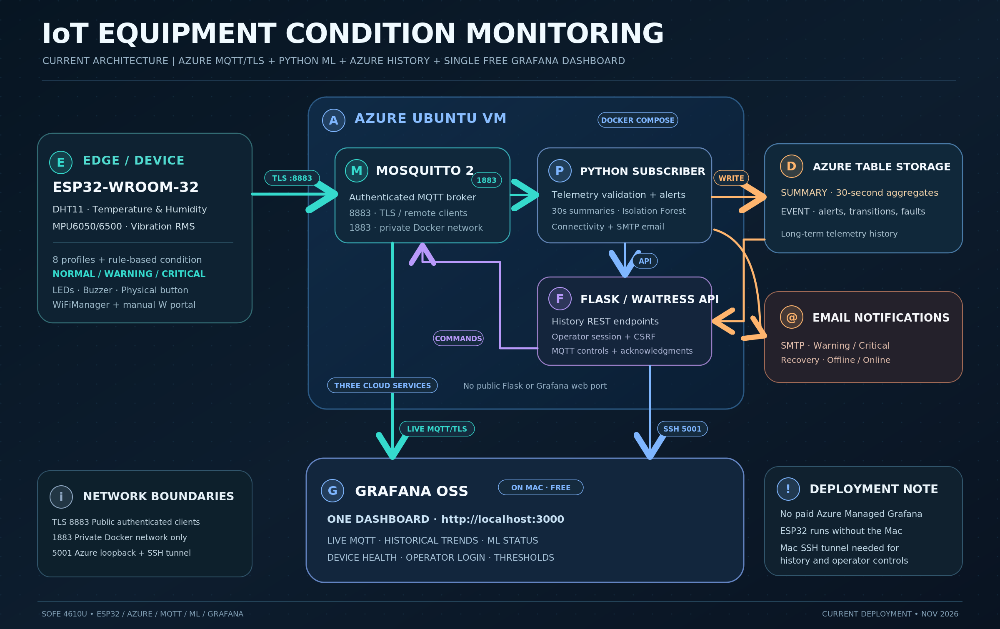
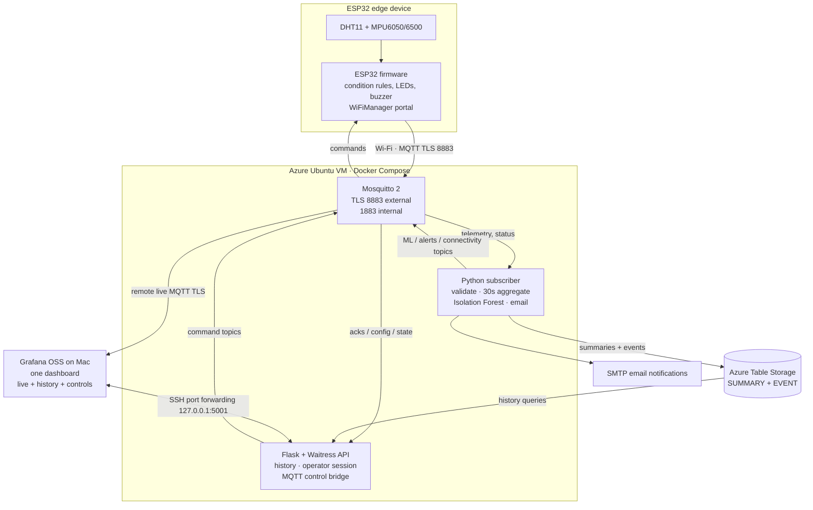

# System Architecture — Current Azure Deployment

> **As implemented:** One ESP32 device, a three-service Docker backend on the Azure Ubuntu VM, Azure Table Storage, and one Grafana OSS dashboard on a Mac. No Azure Managed Grafana subscription.

## End-to-end data and control flow

## 1. Device / edge layer

- **ESP32-WROOM-32**, running `firmware/esp32/equipment_monitor/equipment_monitor.ino`.
- **DHT11** at GPIO27 provides ambient temperature and relative humidity; **MPU6050/MPU6500** on I²C GPIO21/22 provides an acceleration-derived vibration RMS estimate.
- Uses configurable limits for the selected one of eight monitoring profiles (`MOTOR`, `PUMP`, `COMPRESSOR`, `FAN`, `CONDENSER`, `HEAT_EXCHANGER`, `AHU`, `CHILLER`). Outputs `NORMAL`, `WARNING`, or `CRITICAL` separately from ML results.
- Local LEDs indicate condition; buzzer and physical button provide audible critical alert acknowledgement. No industrial equipment is directly controlled.
- Samples and publishes every ~2.5 seconds; status is republished around every 15 seconds. Stores settings with ESP32 Preferences.
- **WiFiManager** offers `EquipmentMonitor-Setup` at `http://192.168.4.1`. Entering `W` in Serial Monitor manually opens the portal; switching to another network replaces the active saved network rather than implementing automatic multi-network roaming.

## 2. Secure MQTT communication

| Path | Protocol | Exposure |
|---|---|---|
| ESP32 → Azure Mosquitto | MQTT over TLS, TCP 8883 | Remote internet client, authenticated |
| Mac Grafana → Azure Mosquitto | MQTT over TLS, TCP 8883 | Remote internet client, authenticated |
| Python subscriber/API ↔ Mosquitto | MQTT TCP 1883 | Private Docker network only |

Broker hostname: `iot-monitor-dp0912.northcentralus.cloudapp.azure.com`. The ESP32 and Grafana verify the self-managed server certificate through the trusted root CA. The server private key and password file remain on the Azure VM in `cloud-private/`.

Important topic paths under `equipment/ESP32-001/`: `telemetry`, `status`, `sensor_health`, `config`, `control_status`, `commands`, `command_ack`, `alerts`, `connectivity`, and `ml`.

## 3. Azure processing and ML

The active `compose.cloud.yaml` runs three services with `restart: unless-stopped`:

- **`mosquitto`:** TLS listener, private internal listener, authentication, persistent broker volume.
- **`subscriber`:** MQTT validation, sensor-health and condition-change events, 30-second aggregates, Azure Table writes and retry queue, Isolation Forest inference, connectivity checks and SMTP email worker. Model predictions skip windows containing fault samples.
- **`api`:** Waitress-serving Flask history routes and authenticated operator endpoints; sends device commands via MQTT and processes acknowledgements.

The rule-based ESP32 condition and ML anomaly prediction are **two separate classifications**. ML prediction fields include `status` (`NORMAL`/`ANOMALY`) and `anomaly_score`.

## 4. Azure storage and API

Azure Table Storage persists two kinds of rows:

- `SUMMARY`: 30-second sensor statistics and sample/condition metadata.
- `EVENT`: condition transitions and sensor fault/recovery events.

The API exposes `/api/history/summary`, `/api/history/events`, `/api/health`, `/api/session`, `/api/config`, `/api/profile`, `/api/alarm/ack`, `/api/control/status`, `/api/audit`, and `/api/config/refresh` with HTTP methods and authorization determined by the routes.

The API binds to **`127.0.0.1:5001` on the Azure VM**, not to a public internet-facing port.

## 5. Grafana on the Mac

**One Grafana OSS dashboard** is available at `http://localhost:3000` when the Homebrew service is running.

- **Live data:** `grafana-mqtt-datasource` connects to Azure MQTT over TLS.
- **Historical data:** `Azure-Historical-Data` (Infinity) requests records through the local SSH tunnel to the Azure Flask API.
- **Controls:** dashboard operator forms use the same API tunnel and a separate authenticated session to update thresholds, select a monitoring profile and acknowledge the buzzer.
- **Time range behavior:** Grafana uses one dashboard-wide time range; zooming into old history can make live MQTT panels appear empty until returning to a recent relative range.

The Mac may be on a different Wi-Fi network from the ESP32. The device communicates with Azure independently of the Mac; only local Grafana viewing and tunneled API control require the Mac.

## 6. Alerts, security, and deployment

- MQTT live alerts and connectivity state are visible on Grafana; SMTP email notifications cover configured condition and connectivity events. **SMS is not implemented.**
- Private files: `.env`, `firmware/esp32/equipment_monitor/secrets.h`, `cloud-private/`, certificate signing/server keys, and the Mosquitto password file. Do not commit any of them.
- Grafana OSS software is free; Azure VM/storage usage may incur charges.
- Full operating procedure and commands: [Operations guide](../guides/02_OPERATIONS_GUIDE.md) and [README quick start](../../README.md#-run-the-existing-deployment).

**Limitation:** Educational monitoring prototype; no calibrated industrial-grade fault diagnosis or certified machinery protection.
