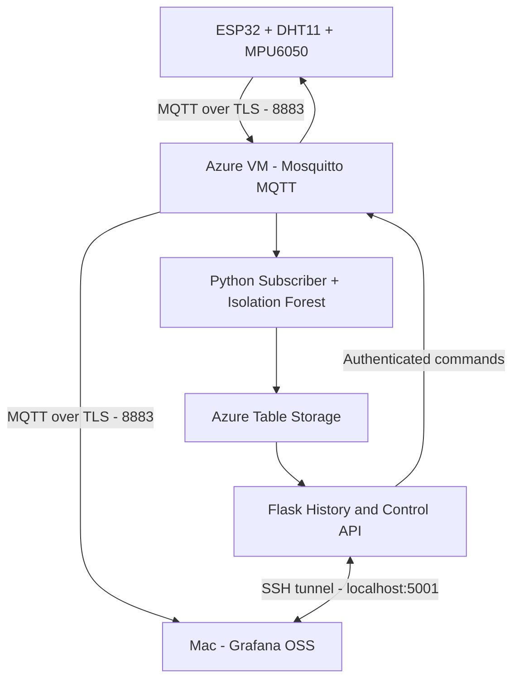

# System Architecture — Azure Deployment

## Current implementation

The system uses one ESP32, an Azure Ubuntu VM, Azure Table Storage,
and one Grafana OSS dashboard running on the Mac.

## ESP32

- Temperature and humidity: DHT11, GPIO27
- Vibration: MPU6050/MPU6500, GPIO21 and GPIO22
- Condition classification: NORMAL, WARNING, CRITICAL
- Local indicators: three LEDs and a buzzer
- Physical alarm acknowledgement: GPIO13
- Equipment profiles: eight selectable monitoring profiles

WiFiManager handles Wi-Fi onboarding.

The ESP32 creates `EquipmentMonitor-Setup` when its saved Wi-Fi
is unavailable. The operator can also enter `W` in Arduino
Serial Monitor to open the setup portal manually.

The portal is accessible at `http://192.168.4.1` while the
computer is connected to `EquipmentMonitor-Setup`.

The ESP32 has been configured on both a home Wi-Fi network and
an iPhone hotspot. This is manual network reconfiguration,
not automatic roaming across multiple saved networks.

## Azure Ubuntu VM

Docker Compose runs three services:

| Service | Responsibility |
|---|---|
| mosquitto | Authenticated MQTT broker |
| subscriber | Telemetry, 30-second summaries, ML, email, Azure writes |
| api | History retrieval and authenticated remote controls |

Deployment file: `compose.cloud.yaml`.

Mosquitto uses TCP 8883 with TLS for remote MQTT clients.
TCP 1883 is used inside Docker and is not publicly published.

The Flask API is bound to `127.0.0.1:5001` on the VM.

## Azure Storage

Azure Table Storage stores SUMMARY and EVENT records.

The Flask API retrieves stored information for Grafana
historical graphs and event tables.

## Mac Grafana

Grafana OSS runs locally at `http://localhost:3000`.

One dashboard contains:
- Live temperature, humidity, vibration and equipment status
- MQTT connectivity, sensor health and ML anomaly information
- Azure historical trends and alerts
- Operator authentication, profiles and thresholds

The MQTT data source connects directly to the Azure broker
using TLS and the trusted private-CA certificate.

The Infinity data source accesses the Flask API over an
SSH local-port-forwarding tunnel.

Historical zooming changes the dashboard-wide time range.
Live panels may show No data while older dates are selected.

## Notifications

SMTP email notifications support equipment condition changes,
recovery, offline and online events.

SMS notifications are planned, not implemented.

## Security

Private MQTT passwords, Azure credentials, server certificate
private keys and operator secrets remain outside Git.

Grafana and the Flask API are not exposed as public web
services in the current deployment.

This is an educational IoT prototype, not a certified
industrial protection or machine-control system.
